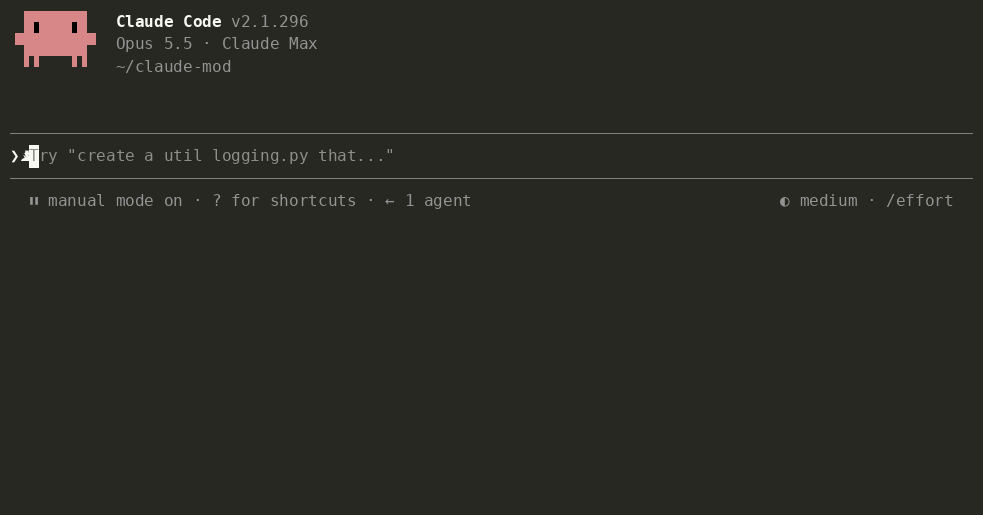

# Tidia — Diktate für Claude Code bereinigen

**Klare Diktate für die KI.** Frei sprechen. Klar senden.

<!-- languages:start -->
[English](README.md) · [한국어](README.ko.md) · [日本語](README.ja.md) · [简体中文](README.zh.md) · [繁體中文](README.zh-TW.md) · [Español](README.es.md) · Deutsch · [Français](README.fr.md) · [Português (Brasil)](README.pt-BR.md) · [Русский](README.ru.md) · [हिन्दी](README.hi.md) · [Bahasa Indonesia](README.id.md)
<!-- languages:end -->



Tidia (*TID-ee-a*) bereinigt den Text, den Claude Codes integrierte Diktierfunktion ins Eingabefeld schreibt, bevor du ihn sendest. Es funktioniert mit `/voice` im Terminal und der Mikrofontaste in der Desktop-App.

- Entfernt Füllwörter („um“, „음“, „えーと“), Wiederholungen und verworfene Satzanfänge. Nach einer gesprochenen Korrektur bleibt die endgültige Aussage.
- Stellt die englische Schreibweise phonetisch erkannter Begriffe wieder her („리액트“ → React, „깃 푸시“ → git push) und übernimmt die tatsächliche Schreibweise von Dateien und Namen aus dem Gespräch.
- Erhält deinen Inhalt. Es antwortet, übersetzt und fasst nicht zusammen. Scheitert die Bereinigung oder wirkt sie falsch, wird das Original gesendet.

## Installation

```
/plugin marketplace add fbwndrud/tidia
/plugin install tidia@tidia
```

Benötigt Claude Code ab 2.1.296. Auf macOS getestet; Linux und Windows sind noch nicht getestet. Einen Klon ohne Installation ausprobieren: `claude --plugin-dir /path/to/tidia`.

## Verwendung

Diktiere wie gewohnt und drücke Enter. Die bereinigte Fassung wird gesendet.

- Einmalige Bereinigung beim Senden: ein Modellaufruf pro Nachricht. Der Versand wartet einige Sekunden. Sprechpausen lösen keine Bereinigung aus.
- `polish`, der Standard, formuliert eine kurze, klare Nachricht und mehrere Anliegen als Liste. `minimal` entfernt nur Füllwörter und behält deine Formulierungen: „Behalte meine Worte und entferne nur Füllwörter.“
- Terminal und Desktop zeigen den gesendeten Text. Auf dem Desktop bleibt er auch nach einem Sitzungswechsel oder Neustart sichtbar. `message_view` bietet drei Ansichten:

  | `tidied` (Standard) | `labeled` | `full` |
  |---|---|---|
  | Nur gesendeter Text | Bearbeitung durch Tidia + gesendeter Text | Originaldiktat + Bearbeitung + gesendeter Text |
  | „Zeige nur den bereinigten Text“ | „Zeige die Art der Bearbeitung“ | „Zeige auch mein Originaldiktat“ |

  Bei `labeled` und `full` wird angezeigt, wenn eine bedingte Ausgaberegel angewendet wurde. Mit `bubble_labels` kannst du Claude bitten, die Beschriftungen zu ändern.
- Für eine Bereinigung bei jeder Pause: „Bereinige mein Diktat bei jeder Sprechpause.“ Die Vorschau erscheint über dem Eingabefeld und Enter sendet sie. Das kostet einen Modellaufruf pro Pause, häufig 2–4 pro Nachricht. Die Vorschau ist nicht editierbar: Änderst du das Eingabefeld, wird dein geänderter Text unverändert gesendet.
- Manuelle Änderungen vor dem Senden verwerfen die Bereinigung. Getippter Text wird nie bereinigt.
- „Zeige die Details der Diktatbereinigung“ zeigt Hinweise und Gründe für einen Versand ohne Bereinigung.

## Mit Claude sprechen

Du kannst die Einstellungen per Sprache ändern:

- „Füge Tailscale meinem Sprachwörterbuch hinzu.“ / „Nein, ich sagte Tailscale.“
- „Behalte meine Worte, entferne nur Füllwörter.“ / „Schalte die Bereinigung vorerst aus.“
- „Schreibe bei einem Fehlerbericht das Problem, die Schritte und das erwartete Ergebnis.“
- „Sende meine Diktate immer als nummerierte Liste mit einer Zusammenfassung in einem Satz.“ / „Verwende normale Sätze.“
- „Verwende einen höflichen Ton.“ / „Meine Nachrichten sollen kurz und sachlich sein.“

Ton und Aufbau werden als Ausgaberegeln gespeichert, die immer oder nur unter einer Bedingung gelten. Sieben Startregeln —Fehlerberichte, Funktionswünsche, Reviews, Aufgabenlisten sowie höflicher, lockerer oder gesprochener Ton— bleiben aus, bis du sie anforderst.

Erkennt Claude ein falsch verstandenes Wort, fügt es das Wort dem Wörterbuch hinzu und meldet es; „Mach das rückgängig“ entfernt es. Änderungen an Einträgen, die Claude nicht selbst hinzugefügt hat, erfordern Zustimmung. `dict_approval ask` verlangt eine Nachfrage vor jeder Wörterbuchänderung. Auch Regeln und Einstellungen benötigen Zustimmung, außer Claude Codes Berechtigungsmodus erlaubt Tidias Werkzeuge bereits. Alte Einstellungen werden beim ersten Start nach einem Update übernommen.


## Kosten und Datenschutz

- **Ein Modellaufruf pro Bereinigung**, standardmäßig sonnet: etwa 1.000 Tokens feste Anweisungen plus ungefähr die doppelte Diktatlänge. Kurze Diktate benötigen etwa 1.000–1.500 Tokens; lange oder mehrere Regeln ungefähr 2.000. Das zählt zu deiner Claude-Nutzung. „Verwende haiku für die Bereinigung“ spart Zeit und Kosten.
- Diktat, bis zu 300 Zeichen des Eingabefelds auf jeder Seite, Schreibweisen aus Wörterbuch und letzten Gesprächsnachrichten sowie Ausgaberegeln gehen über die Anthropic-Verbindung der Sitzung. `/tidia dict build` fragt zuerst und sendet nur Wortkandidaten in einem Aufruf. Es gibt keinen weiteren Server und keine Telemetrie.
- Tidia verarbeitet kein Audio. Lokal bleiben die letzten 50 bereinigten Nachrichten mit Diktat und gesendetem Text, damit die Ansicht wiederhergestellt werden kann: immer auf dem Desktop, im Terminal mit `labeled` oder `full`. Sehr lange Nachrichten bleiben nur bis zum Sitzungsende. Außerdem werden bis zu 200 Korrekturpaare, das Wörterbuch und Fingerabdrücke der letzten 200 gesendeten Eingaben gespeichert —32-Bit-Hashes, keine Texte—, damit mit ↑ zurückgeholte Eingaben nicht erneut bereinigt werden. Weitere Diktate werden nicht gespeichert.
- Claude erhält eine in deiner Nachricht unsichtbare Zeile mit einem festen Hinweis und dem Originaldiktat als JSON. Hast du das Ergebnis selbst geändert, gilt die Nachricht als deine Absicht und das Diktat nur als Referenz. Getippte Nachrichten und unveränderte Diktate erhalten diese Zeile nicht. `attach_raw off` schaltet sie ab. Einmal pro Sitzung und nach einer Kompaktierung erhält Claude eine kurze Anleitung zum Umgang mit diesen Zeilen, Wörtern und Regeln.

## Weitere Informationen

[Architektur](docs/architecture.md) und [Referenz](docs/reference.md), auf Englisch, erklären Funktionsweise, Befehle, Einstellungen, Wörterbuch und Regeln.

**Grenzen.** Die VS-Code-Erweiterung hat kein Band und zeigt keine Debug-Details. Diktate unter drei Wörtern bleiben unverändert. „Mach es kürzer“ oder „Senden“ wird als Text bereinigt, nicht ausgeführt. Da die Spracherkennung die Betonung verliert, kann eine Frage ohne Fragewort als Aussage enden; Claude erhält das Original zur Prüfung.

**Sprachen.** README-Dateien und Oberflächenmeldungen gibt es in 12 Sprachen. `ui_language auto` folgt Claude Codes Sprache; `/tidia set ui_language de` wählt Deutsch. Nicht unterstützte Sprachen verwenden Englisch. Die Bereinigung funktioniert in jeder Sprache, die Claude schreibt. Sprachspezifische Bedeutungsprüfungen und der Evaluationssatz decken weiterhin acht Sprachen ab: Koreanisch, Englisch, Japanisch, Chinesisch, Spanisch, Deutsch, Französisch und Portugiesisch (162 von 164 Fällen in einem sonnet-Durchlauf). Neue Übersetzungen erweitern diese Validierung nicht.

**Falsch bereinigt?** [Öffne ein Issue](https://github.com/fbwndrud/tidia/issues/new?template=cleanup.yml) mit dem gesprochenen und gesendeten Text. Jede Meldung wird ein Testfall.

## Entwicklung

```bash
claude plugin test .
claude plugin validate --strict .
npx -y -p typescript@5.6.3 tsc -p .
```

Die Typprüfung liest die Engine-Deklarationen aus `.claude-plugin/types/`, die Claude Code beim ersten Laden mit `claude --plugin-dir .` schreibt. Prüfe Einstellungen mit `bun scripts/check-settings.ts` und Übersetzungslinks mit `python3 scripts/check-translations.py`.

`eval/` enthält 164 Diktate in acht Sprachen: KI-Texte, mit der Mac-Sprachausgabe gesprochen und der Mac-Spracherkennung transkribiert. `python3 -I eval/run.py` bereinigt sie mit dem echten Modell. [EVAL.md](EVAL.md) beschreibt Methode und Grenzen; [manuelle Prüfungen](docs/manual-checks.md) behandeln Mikrofontests.

## Lizenz

MIT
