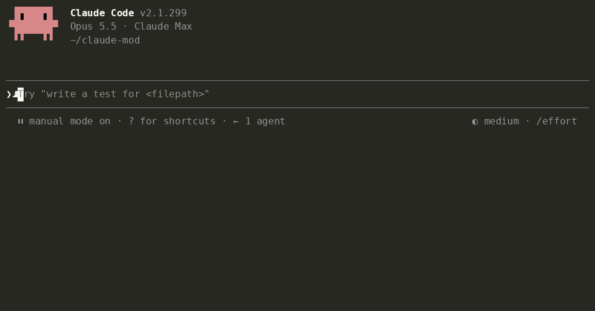

# Tidia — limpieza del dictado para Claude Code

**Dictado limpio para la IA.** Habla sin preocuparte. Envía un texto claro.

[](https://github.com/fbwndrud/tidia/releases/latest) [](https://code.claude.com/) [](LICENSE)

<!-- languages:start -->
[English](README.md) · [한국어](README.ko.md) · [日本語](README.ja.md) · [简体中文](README.zh.md) · [繁體中文](README.zh-TW.md) · Español · [Deutsch](README.de.md) · [Français](README.fr.md) · [Português (Brasil)](README.pt-BR.md) · [Русский](README.ru.md) · [हिन्दी](README.hi.md) · [Bahasa Indonesia](README.id.md)
<!-- languages:end -->

[Instalación](#install) · [Uso](#use) · [Hablar con Claude](#voice-settings) · [Coste y privacidad](#privacy) · [Más información](#help)

Tidia (*TID-ee-a*) limpia el texto que el dictado integrado de Claude Code escribe en el campo de entrada antes de enviarlo. Funciona con `/voice` en la terminal y con el botón del micrófono en la aplicación de escritorio.

- Elimina muletillas («um», «음», «えーと»), repeticiones y comienzos descartados; conserva lo que finalmente dijiste tras corregirte.
- Recupera la escritura inglesa de términos transcritos fonéticamente («리액트» → React, «깃 푸시» → git push) y la escritura real de archivos y nombres de la conversación.
- Conserva el contenido. No responde, traduce ni resume. Si la limpieza falla o parece incorrecta, envía el original.

<a id="install"></a>

## Instalación

Requiere **Claude Code 2.1.296 o posterior**. Probado en macOS; Linux y Windows aún no se han probado.

Ejecuta esta línea en la **terminal**, fuera de la conversación con Claude:

```bash
claude plugin install tidia --marketplace fbwndrud/tidia
```

Se instala para tu usuario en todos los proyectos. Reinicia Claude Code o abre una nueva sesión de Code en la aplicación de escritorio y comprueba que está activo con `/tidia`. No necesitas otra clave de API.

<details>
<summary>Otras formas de instalar</summary>

En una conversación de Claude Code, ejecuta cada línea por separado y elige **Install for you**:

```text
/plugin marketplace add fbwndrud/tidia
/plugin install tidia@tidia
```

Solo para este repositorio: añade `--scope local` al comando de terminal. Para probar un clon: `claude --plugin-dir /path/to/tidia`.

[Claude Code · plugin installation](https://code.claude.com/docs/en/plugins/install#add-a-marketplace-and-install-in-one-command)

</details>

### Actualizar

Ejecuta estos comandos en la terminal y reinicia Claude Code:

```bash
claude plugin marketplace update tidia
claude plugin update tidia@tidia
```

Actualizaciones automáticas: `/plugin` → **Marketplaces** → **tidia** → **Enable auto-update**. Están desactivadas por defecto en los mercados de terceros.

<details>
<summary>Desinstalar</summary>

```bash
claude plugin uninstall tidia@tidia
```

</details>

<a id="use"></a>

## Uso

Para empezar, activa `/voice` en la terminal o pulsa el micrófono en la pestaña **Code** de la aplicación de escritorio. Habla y envía el mensaje; no hay que configurar nada.

Dicta como siempre y pulsa Enter para enviar la versión limpia.


<details>
<summary>Estilos, vistas y vista previa en las pausas</summary>

- Se limpia una vez al pulsar Enter: una llamada al modelo por mensaje. El envío espera unos segundos. Una pausa al hablar no inicia la limpieza.
- `polish`, el estilo predeterminado, redacta un mensaje breve y claro y convierte varias peticiones en una lista. `minimal` solo elimina muletillas y conserva tus palabras: pide a Claude «conserva mis palabras y quita solo las muletillas».
- En la terminal y el escritorio ves el mensaje enviado. En el escritorio se conserva al cambiar de sesión o reiniciar la aplicación. `message_view` ofrece tres vistas:

  | `tidied` (predeterminada) | `labeled` | `full` |
  |---|---|---|
  | Solo el texto enviado | Qué hizo Tidia + texto enviado | Dictado original + qué hizo Tidia + texto enviado |
  | «Muestra solo el mensaje limpio» | «Muestra el tipo de limpieza» | «Muestra también mi dictado original» |

  En `labeled` y `full` se indica si se aplicó una regla condicional. Puedes cambiar las etiquetas con `bubble_labels` hablando con Claude.
- Para limpiar en cada pausa, pide «limpia mi dictado cuando deje de hablar». La vista previa aparece sobre el campo y Enter la envía. Esto usa una llamada por pausa, normalmente 2–4 por mensaje. La vista previa no se puede editar: si modificas el campo, se envía lo que escribiste, sin limpiar.
- Si editas el campo antes de enviar, se descarta la limpieza. El texto escrito con el teclado nunca se limpia.
- Pide «muestra los detalles de la limpieza del dictado» para ver avisos y por qué un mensaje se envió sin limpiar.

</details>

<a id="voice-settings"></a>

## Hablar con Claude

No necesitas configurar todo manualmente. Puedes pedir:

- «Añade Tailscale a mi diccionario de voz». / «No, dije Tailscale».
- «Conserva mis palabras y quita solo las muletillas». / «Desactiva la limpieza por ahora».
- «Cuando informe de un error, escribe el síntoma, los pasos y el resultado esperado».
- «Envía siempre mi dictado como una lista numerada y un resumen de una línea». / «Usa frases normales».
- «Usa un tono cortés». / «Mis mensajes deben ser breves y directos».

<details>
<summary>Reglas de salida y permisos del diccionario</summary>

El tono y el formato se guardan como reglas de salida, que se aplican siempre o cuando se cumple una condición. Las siete reglas iniciales —errores, peticiones de funciones, revisiones, tareas y tono cortés, informal o tal como hablas— permanecen desactivadas hasta que las pidas.

Cuando Claude identifica una palabra mal reconocida, la añade al diccionario y te avisa; «deshaz eso» la elimina. Para cambiar entradas que no añadió él, pide permiso. Con `dict_approval ask` pregunta antes de cualquier cambio. También pregunta antes de cambiar reglas o ajustes, salvo que el modo de permisos de Claude Code ya autorice las herramientas de Tidia. Los ajustes antiguos se migran en el primer inicio tras actualizar.



</details>

<a id="privacy"></a>

## Coste y privacidad

Cada limpieza usa una llamada al modelo mediante tu conexión de Claude. Por defecto, una por mensaje dictado enviado. No procesa audio ni envía telemetría; guarda transcripciones recientes y ajustes localmente.

<details>
<summary>Coste de tokens, datos guardados y lo que recibe Claude</summary>

- **Una llamada al modelo por limpieza**, con sonnet por defecto: unas 1.000 fichas de instrucciones fijas más aproximadamente el doble de la longitud del dictado. Un mensaje corto usa unas 1.000–1.500 fichas; uno largo o con varias reglas, unas 2.000. Cuenta para tu uso de Claude. Pide «usa haiku para limpiar el dictado» para reducir tiempo y coste.
- Se envían el dictado, hasta 300 caracteres del campo a cada lado, pistas de escritura del diccionario y de los últimos mensajes, y las reglas de salida mediante la conexión Anthropic de la sesión. `/tidia dict build` pide permiso y envía solo palabras candidatas en una llamada. No hay otro servidor ni telemetría.
- Tidia no procesa audio. Guarda localmente los últimos 50 mensajes limpios, con el dictado y el texto enviado, para restaurar su vista: siempre en el escritorio y en la terminal con `labeled` o `full`. Los mensajes muy largos se conservan solo durante la sesión. También guarda hasta 200 pares de correcciones, el diccionario y las huellas de los últimos 200 mensajes enviados —hashes de 32 bits, no sus textos— para no volver a limpiar mensajes recuperados con ↑. No almacena más dictados.
- Claude recibe una línea que no aparece en tu mensaje: una explicación fija y el dictado original en JSON. Si editaste el resultado, indica que el mensaje expresa tu intención y el dictado es solo referencia. No se añade a texto escrito ni a dictados sin cambios. `attach_raw off` la desactiva. Una vez por sesión y tras una compactación, Claude recibe una breve guía para interpretarla y gestionar palabras y reglas.

</details>

<a id="help"></a>

## Más información

[Arquitectura](docs/architecture.md) y [referencia](docs/reference.md), en inglés, explican el funcionamiento, los comandos, los ajustes, el diccionario y las reglas.

<details>
<summary>Compatibilidad, idiomas y límites</summary>

**Límites.** La extensión de VS Code no tiene banda y no muestra detalles de depuración. Los dictados de menos de tres palabras se mantienen intactos. «Hazlo más corto» o «envía» se limpian como texto, no se ejecutan. Al perder la entonación, una pregunta sin palabra interrogativa puede convertirse en afirmación; Claude recibe el original para comprobarlo.

**Idiomas.** Los README y los mensajes de interfaz están disponibles en 12 idiomas. `ui_language auto` sigue el idioma de Claude Code; por ejemplo, `/tidia set ui_language es` selecciona español. Los idiomas no admitidos usan inglés. La limpieza funciona en cualquier idioma que Claude escriba. Las comprobaciones específicas de significado y el conjunto de evaluación siguen cubriendo ocho idiomas: coreano, inglés, japonés, chino, español, alemán, francés y portugués (162 de 164 casos en una ejecución con sonnet). Las traducciones nuevas no amplían esa validación.

</details>

**¿Se limpió mal?** [Abre una incidencia](https://github.com/fbwndrud/tidia/issues/new?template=cleanup.yml) con lo que dijiste y lo que se envió. Cada informe se convierte en un caso de prueba.

<a id="development"></a>

## Desarrollo

<details>
<summary>Comprobaciones y evaluación para desarrolladores</summary>

```bash
claude plugin test .
claude plugin validate --strict .
npx -y -p typescript@5.6.3 tsc -p .
```

La comprobación de tipos lee las declaraciones del motor en `.claude-plugin/types/`, creadas al cargar el mod por primera vez con `claude --plugin-dir .`. Comprueba también los ajustes con `bun scripts/check-settings.ts` y los enlaces de traducción con `python3 scripts/check-translations.py`.

`eval/` contiene 164 dictados en ocho idiomas, escritos por IA, leídos con síntesis de voz de macOS y transcritos por su reconocimiento de voz. `python3 -I eval/run.py` los limpia con el modelo real. [EVAL.md](EVAL.md) describe el método y los límites; [comprobaciones manuales](docs/manual-checks.md) recoge las pruebas de micrófono.

</details>

<a id="license"></a>

## Licencia

MIT
