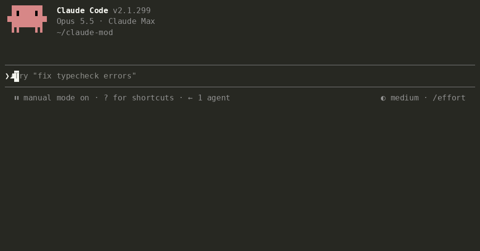

# Tidia — nettoyage de la dictée pour Claude Code

**Une dictée claire pour l’IA.** Parlez librement. Envoyez un texte net.

<!-- languages:start -->
[English](README.md) · [한국어](README.ko.md) · [日本語](README.ja.md) · [简体中文](README.zh.md) · [繁體中文](README.zh-TW.md) · [Español](README.es.md) · [Deutsch](README.de.md) · Français · [Português (Brasil)](README.pt-BR.md) · [Русский](README.ru.md) · [हिन्दी](README.hi.md) · [Bahasa Indonesia](README.id.md)
<!-- languages:end -->


Tidia (*TID-ee-a*) nettoie le texte saisi par la dictée intégrée de Claude Code avant son envoi. Il fonctionne avec `/voice` dans le terminal et le bouton du microphone de l’application de bureau.

- Supprime les hésitations (« um », « 음 », « えーと »), répétitions et débuts abandonnés, et conserve votre formulation finale après une correction orale.
- Rétablit l’orthographe anglaise des termes transcrits phonétiquement (« 리액트 » → React, « 깃 푸시 » → git push) et l’écriture exacte des fichiers et noms de la conversation.
- Préserve le contenu. Il ne répond pas, ne traduit pas et ne résume pas. Si le nettoyage échoue ou semble incorrect, le texte original est envoyé.

## Installation

```
/plugin marketplace add fbwndrud/tidia
/plugin install tidia@tidia
```

Nécessite Claude Code 2.1.296 ou plus récent. Testé sur macOS ; Linux et Windows ne sont pas encore testés. Pour essayer un clone sans l’installer : `claude --plugin-dir /path/to/tidia`.

## Utilisation

Dictez normalement, puis appuyez sur Enter pour envoyer la version nettoyée.

- Le nettoyage a lieu une seule fois, à l’envoi : un appel au modèle par message. L’envoi attend quelques secondes. Une pause pendant la dictée ne lance aucun nettoyage.
- `polish`, par défaut, reformule en un message court et clair, avec une liste pour plusieurs demandes. `minimal` retire seulement les hésitations et conserve vos mots : demandez « garde mes mots et retire seulement les hésitations ».
- Le terminal et le bureau affichent le texte envoyé. Sur le bureau, cet affichage reste après un changement de session ou un redémarrage. `message_view` propose trois vues :

  | `tidied` (par défaut) | `labeled` | `full` |
  |---|---|---|
  | Texte envoyé uniquement | Travail de Tidia + texte envoyé | Dictée originale + travail de Tidia + texte envoyé |
  | « Affiche seulement le texte nettoyé » | « Affiche le type de nettoyage » | « Affiche aussi ma dictée originale » |

  `labeled` et `full` indiquent également l’application d’une règle conditionnelle. Demandez à Claude de changer les libellés avec `bubble_labels`.
- Pour nettoyer à chaque pause, demandez « nettoie ma dictée quand je m’arrête de parler ». L’aperçu apparaît au-dessus du champ et Enter l’envoie. Cela coûte un appel par pause, souvent 2–4 par message. L’aperçu n’est pas modifiable : si vous changez le champ, votre texte est envoyé tel quel.
- Toute modification manuelle du champ annule le nettoyage. Le texte tapé au clavier n’est jamais nettoyé.
- Demandez « affiche les détails du nettoyage de la dictée » pour voir les notifications et les raisons d’un envoi sans nettoyage.

## Parler à Claude

Vous pouvez tout demander par la voix :

- « Ajoute Tailscale à mon dictionnaire vocal. » / « Non, j’ai dit Tailscale. »
- « Garde mes mots, retire seulement les hésitations. » / « Désactive le nettoyage pour l’instant. »
- « Pour un bug, écris le symptôme, les étapes et le résultat attendu. »
- « Envoie toujours ma dictée en liste numérotée, puis un résumé d’une ligne. » / « Utilise des phrases simples. »
- « Utilise un ton poli. » / « Mes messages doivent être courts et directs. »

Le ton et la présentation sont des règles de sortie, appliquées toujours ou sous condition. Les sept règles de départ —bugs, fonctionnalités, revues, tâches et tons poli, familier ou tel que parlé— restent désactivées jusqu’à votre demande.

Lorsque Claude identifie un mot mal reconnu, il l’ajoute au dictionnaire et vous prévient ; « annule ça » le retire. Modifier une entrée qu’il n’a pas ajoutée nécessite votre accord. `dict_approval ask` impose une question avant chaque changement. Les règles et réglages demandent aussi votre accord, sauf si le mode de permissions de Claude Code autorise déjà les outils de Tidia. Les anciens réglages sont migrés au premier démarrage après une mise à jour.



## Coût et confidentialité

- **Un appel au modèle par nettoyage**, avec sonnet par défaut : environ 1 000 tokens d’instructions fixes, plus environ deux fois la longueur de la dictée. Une dictée courte consomme 1 000–1 500 tokens ; une longue ou plusieurs règles, environ 2 000. Cela compte dans votre usage de Claude. Demandez « utilise haiku pour le nettoyage » pour gagner en vitesse et réduire le coût.
- La dictée, jusqu’à 300 caractères du champ de chaque côté, les indices d’orthographe du dictionnaire et des derniers messages, et les règles passent par la connexion Anthropic de la session. `/tidia dict build` demande votre accord et transmet uniquement des mots candidats en un appel. Aucun autre serveur ni télémétrie.
- Tidia ne traite pas l’audio. Il conserve localement les 50 derniers messages nettoyés, dictée et texte envoyé, pour restaurer l’affichage : toujours sur le bureau, et dans le terminal avec `labeled` ou `full`. Les très longs messages ne restent que pendant la session. Il conserve aussi jusqu’à 200 paires de corrections, le dictionnaire et les empreintes des 200 derniers messages envoyés —des hashes de 32 bits, pas les textes— pour éviter un nouveau nettoyage après rappel avec ↑. Aucune autre dictée n’est stockée.
- Claude reçoit une ligne invisible dans votre message, contenant une explication fixe et la dictée originale en JSON. Si vous avez modifié le résultat, elle précise que le message exprime votre intention et que la dictée est une référence. Les messages tapés et les dictées inchangées n’en reçoivent pas. `attach_raw off` la désactive. Une courte aide est envoyée une fois par session et après une compaction pour interpréter ces lignes et gérer les mots et règles.

## Pour aller plus loin

L’[architecture](docs/architecture.md) et la [référence](docs/reference.md), en anglais, présentent le fonctionnement, les commandes, les réglages, le dictionnaire et les règles.

**Limites.** L’extension VS Code n’a pas de bande et n’affiche pas les détails de débogage. Les dictées de moins de trois mots restent intactes. « Fais plus court » ou « envoie » sont nettoyés comme du texte, pas exécutés. L’intonation étant perdue, une question sans mot interrogatif peut devenir une affirmation ; Claude reçoit l’original pour vérifier.

**Langues.** Les README et les messages de l’interface existent en 12 langues. `ui_language auto` suit la langue de Claude Code ; `/tidia set ui_language fr` choisit le français. Les langues non prises en charge utilisent l’anglais. Le nettoyage fonctionne dans toute langue écrite par Claude. Les contrôles spécifiques du sens et le jeu d’évaluation couvrent toujours huit langues : coréen, anglais, japonais, chinois, espagnol, allemand, français et portugais (162 cas sur 164 lors d’un essai avec sonnet). Les nouvelles traductions n’étendent pas cette validation.

**Un nettoyage incorrect ?** [Ouvrez un ticket](https://github.com/fbwndrud/tidia/issues/new?template=cleanup.yml) avec ce que vous avez dit et ce qui a été envoyé. Chaque signalement devient un cas de test.

## Développement

```bash
claude plugin test .
claude plugin validate --strict .
npx -y -p typescript@5.6.3 tsc -p .
```

Le contrôle de types lit les déclarations du moteur dans `.claude-plugin/types/`, créées au premier chargement avec `claude --plugin-dir .`. Vérifiez aussi les réglages avec `bun scripts/check-settings.ts` et les liens des traductions avec `python3 scripts/check-translations.py`.

`eval/` contient 164 dictées en huit langues, écrites par IA, lues par la synthèse vocale de macOS et transcrites par sa reconnaissance vocale. `python3 -I eval/run.py` les nettoie avec le vrai modèle. [EVAL.md](EVAL.md) décrit la méthode et ses limites ; les [vérifications manuelles](docs/manual-checks.md) couvrent le microphone.

## Licence

MIT
