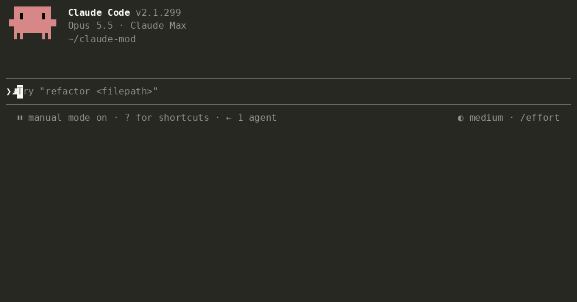

# Tidia — merapikan dikte untuk Claude Code

**Dikte rapi untuk AI.** Bicara bebas. Kirim pesan jelas.

<!-- languages:start -->
[English](README.md) · [한국어](README.ko.md) · [日本語](README.ja.md) · [简体中文](README.zh.md) · [繁體中文](README.zh-TW.md) · [Español](README.es.md) · [Deutsch](README.de.md) · [Français](README.fr.md) · [Português (Brasil)](README.pt-BR.md) · [Русский](README.ru.md) · [हिन्दी](README.hi.md) · Bahasa Indonesia
<!-- languages:end -->


Tidia (*TID-ee-a*) merapikan teks yang ditulis fitur dikte bawaan Claude Code ke kolom prompt sebelum dikirim. Berfungsi dengan `/voice` di terminal dan tombol mikrofon di aplikasi desktop.

- Menghapus kata pengisi («um», «음», «えーと»), pengulangan, dan awal kalimat yang dibatalkan; hanya menyimpan versi akhir setelah Anda mengoreksi ucapan.
- Mengembalikan ejaan Inggris untuk istilah yang ditranskripsikan secara fonetis («리액트» → React, «깃 푸시» → git push), serta memakai ejaan asli berkas dan nama dalam percakapan.
- Mempertahankan isi. Tidak menjawab, menerjemahkan, atau meringkas. Jika perapian gagal atau tampak salah, teks asli dikirim.

## Instalasi

```
/plugin marketplace add fbwndrud/tidia
/plugin install tidia@tidia
```

Memerlukan Claude Code 2.1.296 atau lebih baru. Diuji di macOS; Linux dan Windows belum diuji. Untuk mencoba hasil kloning tanpa instalasi: `claude --plugin-dir /path/to/tidia`.

## Penggunaan

Dikte seperti biasa, lalu tekan Enter untuk mengirim versi rapi.

- Dirapikan sekali saat Enter: satu panggilan model per pesan. Pengiriman menunggu beberapa detik. Jeda saat berbicara tidak memulai perapian.
- `polish`, gaya bawaan, menulis pesan singkat dan jelas serta membuat daftar untuk beberapa permintaan. `minimal` hanya menghapus kata pengisi dan mempertahankan kata-kata Anda: minta «pertahankan kata-kata saya, hapus hanya kata pengisi».
- Terminal dan desktop menampilkan teks yang dikirim. Di desktop, tampilan tetap sama setelah berpindah sesi atau memulai ulang aplikasi. `message_view` menyediakan tiga tampilan:

  | `tidied` (bawaan) | `labeled` | `full` |
  |---|---|---|
  | Teks terkirim saja | Tindakan Tidia + teks terkirim | Dikte asli + tindakan Tidia + teks terkirim |
  | «Tampilkan hanya pesan rapi» | «Tampilkan jenis perapian» | «Tampilkan juga dikte asli» |

  `labeled` dan `full` juga menandai penerapan aturan bersyarat. Minta Claude mengubah label melalui `bubble_labels`.
- Untuk merapikan setiap jeda, minta «rapikan dikte setiap kali saya berhenti bicara». Pratinjau muncul di atas kolom dan Enter mengirimnya. Ini memakai satu panggilan model per jeda, biasanya 2–4 per pesan. Pratinjau tidak dapat diedit: jika Anda mengubah kolom, teks hasil edit dikirim tanpa dirapikan.
- Mengedit kolom sebelum mengirim membatalkan perapian. Teks yang diketik tidak pernah dirapikan.
- Minta «tampilkan detail perapian dikte» untuk melihat pemberitahuan dan alasan pengiriman tanpa dirapikan.

## Bicara dengan Claude

Anda dapat mengubah pengaturan melalui suara:

- «Tambahkan Tailscale ke kamus suara saya.» / «Bukan, saya bilang Tailscale.»
- «Pertahankan kata-kata saya, hapus hanya kata pengisi.» / «Matikan perapian untuk sementara.»
- «Saat saya melaporkan bug, tulis gejala, langkah reproduksi, dan hasil yang diharapkan.»
- «Selalu kirim dikte sebagai daftar bernomor, lalu ringkasan satu baris.» / «Gunakan kalimat biasa.»
- «Gunakan nada sopan.» / «Pesan saya harus singkat dan lugas.»

Nada dan format disimpan sebagai aturan keluaran, berlaku selalu atau saat kondisinya terpenuhi. Tujuh aturan awal —laporan bug, permintaan fitur, ulasan, daftar tugas, serta nada sopan, santai, atau sesuai ucapan— nonaktif sampai Anda memintanya.

Saat yakin sebuah kata salah dikenali, Claude menambahkannya ke kamus dan memberi tahu dalam satu baris; «batalkan itu» menghapusnya. Perubahan entri yang bukan ditambahkan Claude memerlukan izin. `dict_approval ask` meminta izin sebelum setiap perubahan kamus. Aturan dan pengaturan juga meminta izin, kecuali mode izin Claude Code sudah mengizinkan alat Tidia. Pengaturan lama dipindahkan saat pertama kali dijalankan setelah pembaruan.



## Biaya dan privasi

- **Satu panggilan model per perapian**, memakai sonnet secara bawaan: sekitar 1.000 token instruksi tetap ditambah kira-kira dua kali panjang dikte. Dikte singkat memakai sekitar 1.000–1.500 token; yang panjang atau dengan beberapa aturan, sekitar 2.000. Ini dihitung dalam penggunaan Claude Anda. Minta «gunakan haiku untuk perapian» agar lebih cepat dan murah.
- Dikte, hingga 300 karakter kolom pada tiap sisi, petunjuk ejaan dari kamus dan pesan terbaru, serta aturan dikirim melalui koneksi Anthropic milik sesi. `/tidia dict build` meminta izin dan hanya mengirim calon kata dalam satu panggilan. Tidak ada server lain atau telemetri.
- Tidia tidak memproses audio. Secara lokal, ia menyimpan 50 pesan terakhir yang dirapikan —dikte dan teks terkirim— agar tampilannya dapat dipulihkan: selalu di desktop, di terminal dengan `labeled` atau `full`. Pesan sangat panjang hanya disimpan selama sesi. Ia juga menyimpan hingga 200 pasangan koreksi, kamus, dan sidik jari 200 prompt terkirim terakhir —hash 32 bit, bukan teks— agar prompt yang dipanggil kembali dengan ↑ tidak dirapikan lagi. Dikte lain tidak disimpan.
- Claude menerima satu baris yang tidak muncul pada pesan Anda: penjelasan tetap dan dikte asli dalam JSON. Jika Anda mengedit hasilnya, baris itu menyebut pesan sebagai maksud Anda dan dikte sebagai referensi saja. Pesan yang diketik dan dikte tanpa perubahan tidak mendapatkannya. `attach_raw off` menonaktifkannya. Panduan singkat dikirim sekali per sesi dan setelah pemadatan konteks untuk membaca baris tersebut serta mengelola kata dan aturan.

## Informasi lainnya

[Arsitektur](docs/architecture.md) dan [referensi](docs/reference.md), dalam bahasa Inggris, menjelaskan cara kerja, perintah, pengaturan, kamus, dan aturan.

**Batasan.** Ekstensi VS Code tidak memiliki bilah, sehingga detail debug tidak tampil. Dikte kurang dari tiga kata dibiarkan apa adanya. «Persingkat» atau «kirim» dirapikan sebagai teks, bukan dijalankan sebagai perintah. Pengenalan suara menghilangkan intonasi, sehingga pertanyaan tanpa kata tanya dapat menjadi pernyataan; Claude menerima teks asli untuk memeriksanya.

**Bahasa.** README dan pesan antarmuka tersedia dalam 12 bahasa. `ui_language auto` mengikuti bahasa Claude Code; `/tidia set ui_language id` memilih bahasa Indonesia. Bahasa yang tidak didukung memakai bahasa Inggris. Perapian bekerja dalam bahasa apa pun yang dapat ditulis Claude. Pemeriksaan makna khusus bahasa dan kumpulan evaluasi masih mencakup delapan bahasa: Korea, Inggris, Jepang, Mandarin, Spanyol, Jerman, Prancis, dan Portugis (162 dari 164 kasus dalam satu pengujian sonnet). Terjemahan baru tidak memperluas validasi tersebut.

**Hasil perapian salah?** [Buka issue](https://github.com/fbwndrud/tidia/issues/new?template=cleanup.yml) dengan ucapan asli dan teks terkirim. Setiap laporan menjadi kasus uji.

## Pengembangan

```bash
claude plugin test .
claude plugin validate --strict .
npx -y -p typescript@5.6.3 tsc -p .
```

Pemeriksaan tipe membaca deklarasi mesin dalam `.claude-plugin/types/`, dibuat saat pertama memuat dengan `claude --plugin-dir .`. Periksa pengaturan dengan `bun scripts/check-settings.ts` dan tautan terjemahan dengan `python3 scripts/check-translations.py`.

`eval/` berisi 164 dikte dalam delapan bahasa: teks buatan AI yang dibacakan sintesis suara Mac lalu ditranskripsikan pengenalan suara Mac. `python3 -I eval/run.py` merapikannya dengan model asli. [EVAL.md](EVAL.md) menjelaskan metode dan batasannya; [pemeriksaan manual](docs/manual-checks.md) mencakup pengujian mikrofon.

## Lisensi

MIT
