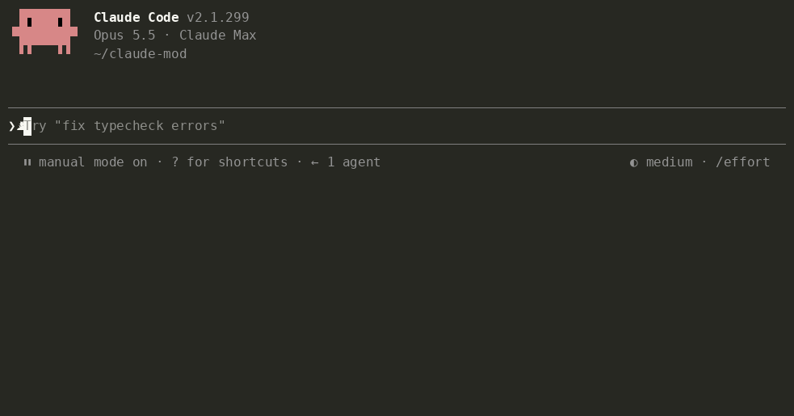

# Tidia — Claude Code の音声入力を整える

**AI に送る音声入力をすっきり。** 自由に話して、整えて送信。

<!-- languages:start -->
[English](README.md) · [한국어](README.ko.md) · 日本語 · [简体中文](README.zh.md) · [繁體中文](README.zh-TW.md) · [Español](README.es.md) · [Deutsch](README.de.md) · [Français](README.fr.md) · [Português (Brasil)](README.pt-BR.md) · [Русский](README.ru.md) · [हिन्दी](README.hi.md) · [Bahasa Indonesia](README.id.md)
<!-- languages:end -->


Tidia（ティディア）は、Claude Code の内蔵音声入力がプロンプトに書き込んだ文章を、送信前に整えます。ターミナルの `/voice` とデスクトップアプリのマイクボタンで動作します。

- 「えーと」「あの」「um」「음」などのつなぎ言葉、繰り返し、言い直す前の部分を削除し、最終的に伝えた内容を残します。
- 音声認識が発音どおりに書いた英語の用語を英語表記に戻し（「リアクト」→ React、「깃 푸시」→ git push）、会話中のファイルや名前も実際の表記に合わせます。
- 内容はそのまま。回答、翻訳、要約はしません。整える処理が失敗したり不自然だったりした場合は、元の文章を送ります。

## インストール

```
/plugin marketplace add fbwndrud/tidia
/plugin install tidia@tidia
```

Claude Code 2.1.296 以降が必要です。macOS で確認済みで、Linux と Windows は未確認です。クローンしたフォルダーからインストールせずに試すには、`claude --plugin-dir /path/to/tidia` を使います。

## 使い方

いつもどおりに話し、Enter を押すと、整えた文章が送られます。

- Enter を押したときに一度だけ整えます。メッセージごとにモデル呼び出しは一回で、送信まで数秒待ちます。話の途中で止まっても処理は始まりません。
- 標準の `polish` は短く明確に書き直し、複数の依頼をリストにします。`minimal` はつなぎ言葉だけを取り除き、自分の言葉を残します。「私の言葉はそのままで、つなぎ言葉だけ消して」と Claude に頼めます。
- ターミナルとデスクトップには、実際に送信した文章が表示されます。デスクトップでは、セッションを切り替えたりアプリを再起動したりしても表示が残ります。`message_view` で表示を選べます。

  | `tidied`（標準） | `labeled` | `full` |
  |---|---|---|
  | 送信した文章だけ | 整え方 + 送信した文章 | 元の音声入力 + 整え方 + 送信した文章 |
  | 「整えた文章だけ見せて」 | 「どう整えたかも見せて」 | 「元の音声入力も見せて」 |

  `labeled` と `full` では、条件付きの出力ルールを適用したことも表示します。表示する言葉は `bubble_labels` として Claude に頼んで変更できます。
- 話が止まるたびに整えるには、「音声入力は止まるたびに整えて」と頼みます。プレビューが入力欄の上に表示され、Enter で送信します。ただし、一回の停止につきモデル呼び出しが一回、通常はメッセージごとに 2〜4 回になります。プレビューは編集できません。入力欄を変更した場合は、変更した文章をそのまま送ります。
- 送信前に入力欄を直接編集すると、整えた文章は破棄されます。キーボードで入力した文章は整えません。
- 「音声入力の整理の詳細を見せて」と頼むと、通知や整えずに送信した理由を表示します。

## Claude に話しかける

設定を手作業で変える必要はありません。例えば、次のように頼めます。

- 「Tailscale を音声辞書に入れて。」／「違う、Tailscale と言ったんだ。」
- 「私の言葉は残して、つなぎ言葉だけ消して。」／「整理をいったんオフにして。」
- 「バグを報告するときは、症状、再現手順、期待する動作の順に書いて。」
- 「音声入力はいつも番号付きリストにして、最後に一行の要約を付けて。」／「普通の文章にして。」
- 「丁寧な口調にして。」／「短く、簡潔な口調にして。」

口調やバグ報告の形式は、出力ルールとして保存します。各ルールは常に適用するか、条件が合うときだけ適用します。七つの初期ルール（バグ報告、機能要望、レビュー、タスク一覧、丁寧・くだけた・話したままの口調）は、頼むまでオフです。

Claude が音声認識の間違いだと判断できた単語は、自動で辞書に追加して一行で知らせます。「元に戻して」で削除できます。Claude が追加していない項目を変える場合は先に確認します。`dict_approval ask` ならすべての辞書変更を確認します。ルールや設定も確認しますが、Claude Code の権限モードが Tidia のツールを許可済みなら確認しません。旧版の設定は、更新後の初回起動時に移行します。



## 費用とプライバシー

- **一回の整理につき一回のモデル呼び出し**で、標準は sonnet です。固定指示が約 1,000 トークン、加えて音声入力の長さの約二倍を使います。短い入力は約 1,000〜1,500、長い入力や複数のルールは約 2,000 トークンです。通常の Claude 利用量に含まれます。「整理には haiku を使って」で速度と費用を抑えられます。
- 音声入力の文章、入力部分の前後それぞれ最大 300 文字、辞書と直近の会話のファイル・識別子の表記ヒント、出力ルールを、セッションの Anthropic 接続で送ります。`/tidia dict build` は先に確認し、候補の単語だけを一回送ります。別のサーバーやテレメトリーはありません。
- 音声データは扱いません。表示を復元するため、最近整えた 50 メッセージ（元の文章と送信した文章）をローカルに保存します。デスクトップは常に、ターミナルは `labeled`・`full` のときに使います。非常に長い文章はセッション中のみ保持します。修正から学んだ単語の組を最大 200 件、辞書、最近送った 200 プロンプトの指紋（文章ではなく 32 ビットのハッシュ）も保存し、↑で呼び戻した入力を再び整えないようにします。ほかの音声入力は保存しません。
- Claude にだけ見える一行には、固定の説明文と元の音声入力の JSON が入ります。自分で編集した場合は、送信した文章が意図した内容で、元の文章は参考用だと伝えます。手入力や変更していない音声入力には付きません。`attach_raw off` で停止できます。各セッションとコンパクション後に一度、読み方と単語・ルールの扱いを簡単に説明します。

## 詳細

英語の[アーキテクチャ](docs/architecture.md)と[リファレンス](docs/reference.md)で、仕組み、コマンド、設定、辞書、ルールを説明しています。

**制限。** VS Code 拡張にはバンドがなく、デバッグの詳細を表示できません。三語未満の入力はそのままです。「短くして」「送信」などは命令として実行せず、文章として整えます。音声認識は抑揚を残さないため、疑問詞のない質問が断定文になることがあります。Claude には元の文章も渡し、確認するよう案内します。

**言語。** README と画面の案内は 12 言語に対応しています。`ui_language auto` は Claude Code の言語設定に従います。日本語を指定するには `/tidia set ui_language ja`。未対応の言語は英語になります。整理自体は Claude が書けるすべての言語で動きます。言語別の意味の検査と評価セットは引き続き八言語（韓国語、英語、日本語、中国語、スペイン語、ドイツ語、フランス語、ポルトガル語）が対象です（sonnet 一回の実行で 164 件中 162 件）。翻訳追加によって評価範囲が広がったわけではありません。

**整理がおかしい場合。** 話した内容と送信された内容を書いて[Issue を作成してください](https://github.com/fbwndrud/tidia/issues/new?template=cleanup.yml)。報告はテストケースになります。

## 開発

```bash
claude plugin test .
claude plugin validate --strict .
npx -y -p typescript@5.6.3 tsc -p .
```

型検査は `.claude-plugin/types/` のエンジン宣言を読みます。初回の `claude --plugin-dir .` で作成されます。設定の整合性は `bun scripts/check-settings.ts`、翻訳のリンクは `python3 scripts/check-translations.py` で確認します。

`eval/` には八言語の音声入力 164 件があります。AI が書いた文章を Mac の音声合成で読み、音声認識で文字にしたものです。`python3 -I eval/run.py` は実際のモデルで整理します。[EVAL.md](EVAL.md)に評価方法と限界、[手動確認](docs/manual-checks.md)にマイクの確認項目があります。

## ライセンス

MIT
