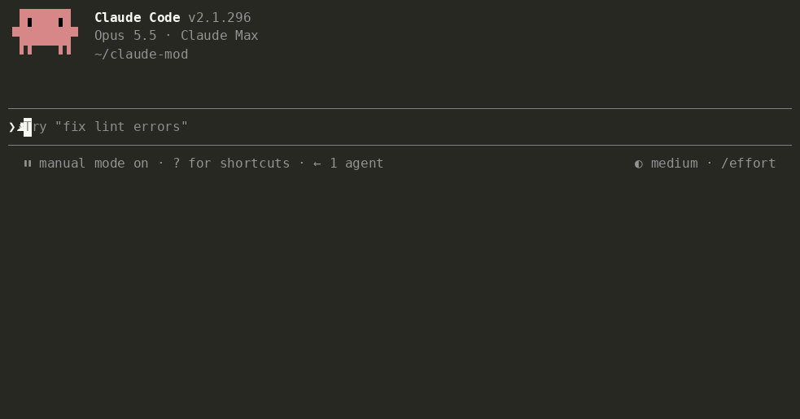

# Tidia — Claude Code 받아쓰기 정리

**막 말해도, 티 없이.** Tidia(티디아)는 tidy dictation for AI, 즉 AI에게 보낼 받아쓰기를 깔끔하게 정리해 준다는 뜻입니다.

[English](README.md)


Tidia는 Claude Code 내장 받아쓰기로 입력창에 들어온 말을, 보내기 전에 정리해 줍니다. 터미널의 `/voice`와 데스크톱 앱의 마이크 버튼 모두에서 동작합니다.

- "음", "어", "그러니까" 같은 군말과 반복, 말하다 고친 앞부분을 지우고 최종적으로 말한 내용만 남깁니다.
- 음성 인식이 소리 나는 대로 적은 영어 용어를 영어로 되돌리고("리액트" → React, "깃 푸시" → git push), 대화에 나온 파일과 이름은 실제 표기대로 씁니다.
- 말한 내용은 그대로 둡니다. 대답하거나 번역하거나 요약하지 않고, 정리가 실패하거나 이상하면 원문을 보냅니다.

## 설치

```
/plugin marketplace add fbwndrud/tidia
/plugin install tidia@tidia
```

Claude Code 2.1.296 이상이 필요합니다. macOS에서 확인했고, Linux와 Windows는 아직 확인하지 않았습니다. 설치 없이 클론한 폴더로 써 보려면 `claude --plugin-dir /path/to/tidia`.

## 사용법

평소처럼 받아쓰고 Enter를 누르면 정리본이 나갑니다.

- Enter를 누를 때 한 번 정리합니다. 메시지 하나에 모델 호출 한 번입니다. 보내기가 몇 초 기다립니다. 말하는 중간에 잠깐 멈춰도 정리하지 않습니다.
- 스타일은 둘입니다. 기본인 `polish`는 짧고 분명한 메시지로 다듬고, 여러 가지를 부탁하면 목록으로 씁니다. `minimal`은 군말만 빼고 내 표현을 그대로 둡니다. Claude에게 "내 말은 그대로 두고 군말만 빼 줘"라고 하세요.
- 메시지는 실제로 보낸 글로 보입니다. 데스크톱과 터미널이 같습니다. 데스크톱은 다른 세션에 갔다 오거나 앱을 다시 켜도 그대로입니다. 무엇이 바뀌었는지 더 보고 싶으면 보기 방식을 바꿀 수 있습니다(`message_view`).

  | `tidied` (기본) | `labeled` | `full` |
  |---|---|---|
  | 보낸 글만 | Tidia가 한 일(`→ 간결화`, `→ 목록화`, `→ 최소 수정`) + 보낸 글 | 말한 원문 + Tidia가 한 일 + 보낸 글 |
  | "정리된 글만 보여 줘" | "메시지에 정리 종류도 보여 줘" | "말한 원문도 같이 보여 줘" |

  `labeled`·`full`에서는 조건이 붙은 출력 규칙을 적용했을 때 `· 규칙 적용`이 붙고, 문구는 Claude에게 말해서 바꿀 수 있습니다(`bubble_labels`).
- 멈출 때마다 미리 정리해서 Enter로 나갈 글을 미리 보려면 Claude에게 "받아쓰기는 멈출 때마다 정리해 줘"라고 하세요.
- 보내기 전에 입력창을 직접 고치면 정리본은 버리고 보이는 그대로 보냅니다. 키보드로 친 글은 정리하지 않습니다.
- Tidia가 하는 일과 정리 없이 나간 이유를 더 보려면 "받아쓰기 정리 자세히 보여 줘"라고 하세요.

## Claude에게 말하기

키보드로 하나하나 설정할 필요가 없습니다. Claude에게 말하세요.

- "Tailscale를 음성 사전에 넣어 줘." / "아니 그거 Tailscale야."
- "내 말은 그대로 두고 군말만 빼 줘." / "받아쓰기 정리 잠깐 꺼 줘."
- "버그 얘기할 땐 증상, 재현, 기대 순서로 정리해 줘."
- "받아쓰기는 항상 번호 목록으로, 끝에 한 줄 요약 붙여서 정리해 줘." / "받아쓰기는 목록 말고 문장으로 보내 줘."
- "받아쓰기는 존댓말로 정리해 줘." / "내 메시지는 짧고 단정한 말투로 해 줘."

어투부터 버그 보고 형식까지, 받아쓴 메시지를 어떻게 쓸지는 모두 출력 규칙 하나의 목록에 들어갑니다. 규칙마다 항상 적용하거나, 조건이 맞을 때만 적용합니다. 기본 규칙 7개(버그 보고, 기능 요청, 리뷰, 작업 목록, 존댓말·반말·말한 말투 그대로)는 말하기 전까지 꺼져 있습니다.

받아쓴 말에서 잘못 알아들은 단어가 확실하면 Claude가 알아서 사전에 넣고 한 줄로 알려 줍니다. "취소해"라고 하면 지웁니다. Claude가 넣지 않은 항목은 묻고 나서만 바꾸고, "사전 바꾸기 전에 물어봐"(`dict_approval ask`)라고 하면 사전 변경을 모두 먼저 묻습니다. 규칙과 설정을 바꿀 때는 먼저 묻습니다. 단, Claude Code 권한 모드가 Tidia 도구를 이미 허용했다면 묻지 않습니다. 이전 버전에서 저장한 설정은 업그레이드 후 첫 시작 때 옮겨집니다.



## 비용과 개인정보

- **정리 한 번에 모델 호출 한 번**, 기본 sonnet입니다. 고정 지침 약 1,000토큰에 받아쓴 내용 길이의 약 두 배가 더해집니다. 짧은 받아쓰기는 약 1,000~1,500토큰, 길거나 출력 규칙이 여럿이면 2,000토큰 안팎까지 씁니다. 다른 요청처럼 Claude 사용량에 포함됩니다. 더 빠르고 저렴하게 쓰려면 "받아쓰기 정리는 haiku로 해 줘".
- 정리할 때 받아쓴 글, 받아쓴 부분 앞뒤로 각각 입력창 글 최대 300자, 표기 힌트(사전 항목과 최근 대화에 나온 파일·식별자 이름), 출력 규칙을 세션이 쓰는 Anthropic 연결로 보냅니다. `/tidia dict build`는 먼저 묻고, 후보 단어만 한 번의 호출로 보냅니다. 그 밖의 서버나 원격 수집은 없습니다.
- 오디오는 다루지 않습니다. 앱을 다시 켜도 같은 모습으로 보이도록, 최근 정리한 메시지 50개(말한 원문과 보낸 글)를 이 컴퓨터의 Tidia 저장소에 둡니다. 데스크톱은 항상, 터미널은 `message_view`가 labeled·full일 때입니다(아주 긴 메시지는 세션이 끝날 때까지만). 내 수정에서 배운 단어 짝(최대 200개)과 사전도 저장합니다. 그 밖에 받아쓴 내용은 저장하지 않습니다.
- 정리된 메시지에는 Claude만 받는 한 줄이 붙습니다. 내 메시지 화면에는 보이지 않고, 안내 문장 하나와 받아쓴 원문만 들어 있습니다. Claude에게 가는 글이라 영어로 씁니다. 예:

  `[tidia] Dictated by voice and tidied before sending; where the meaning differs, this raw transcript is what the user said (JSON): "음 그러니까 리액트에서 유즈 이펙트가 어 두 번 실행돼"`

  (뜻: 음성으로 받아써서 보내기 전에 정리함. 뜻이 다른 곳은 이 원문이 사용자가 실제로 한 말.) 보내기 전에 정리본을 직접 고쳤다면, 메시지가 내가 뜻한 것이고 원문은 참고용이라고 적힙니다. 타이핑한 메시지와 Tidia가 바꾸지 않은 받아쓰기에는 붙지 않습니다. `attach_raw off`로 끌 수 있습니다. 세션마다 한 번(압축 뒤에도 한 번), 이 줄을 읽는 법과 잘못 알아들은 단어나 규칙을 언제 넣을지 짧게 안내합니다.

## 더 보기

동작 원리는 그림과 함께 [docs/architecture.ko.md](docs/architecture.ko.md)에 있습니다. 밴드 키, 명령, 모든 설정, 사전, 출력 규칙은 [docs/reference.ko.md](docs/reference.ko.md)에 있습니다.

**한계.** VS Code 확장에는 밴드가 없어서 debug 표시가 나오지 않습니다. 세 단어 미만의 받아쓰기는 그대로 둡니다. "더 짧게", "보내" 같은 음성 명령은 따르지 않고 글로 정리합니다. 음성 인식은 억양을 남기지 않아서, 물음표 없이 말한 질문이 단정문으로 정리될 수 있습니다. Claude는 원문을 함께 받고 확인하도록 안내받습니다.

**언어.** 정리 자체는 Claude가 쓰는 모든 언어에서 동작합니다. 의미가 뒤집히거나 요청 대신 답이 나간 경우를 잡는 검사와 골든셋은 8개 언어를 다룹니다: 한국어, 영어, 일본어, 중국어, 스페인어, 독일어, 프랑스어, 포르투갈어(164개 중 162개 통과, sonnet 1회 실행).

**정리가 이상한가요?** 말한 것과 보내진 것을 적어 [이슈를 열어 주세요](https://github.com/fbwndrud/tidia/issues/new?template=cleanup.yml). 제보 하나가 테스트 케이스 하나가 됩니다.

## 개발

```bash
claude plugin test .
```

```bash
claude plugin validate --strict .
```

```bash
npx -y -p typescript@5.6.3 tsc -p .
```

타입 검사는 `.claude-plugin/types/`의 엔진 선언을 읽습니다. 이 폴더는 Claude Code가 mod를 처음 불러올 때(`claude --plugin-dir .`) 만듭니다.

`eval/`에는 8개 언어의 받아쓰기 164개 골든셋(AI가 쓴 문장을 Mac 음성 합성으로 읽혀 Mac 음성 인식으로 받아쓴 것)과, 실제 모델로 정리해서 결과를 확인하는 실행기(`python3 -I eval/run.py`)가 있습니다. 평가 방법, 최신 결과, 결과가 보여 주지 못하는 것은 [EVAL.md](EVAL.md)(영문)에 있습니다. `docs/manual-checks.md`에는 자동 테스트로 다룰 수 없는 마이크 확인 항목이 있습니다.

## 라이선스

MIT
