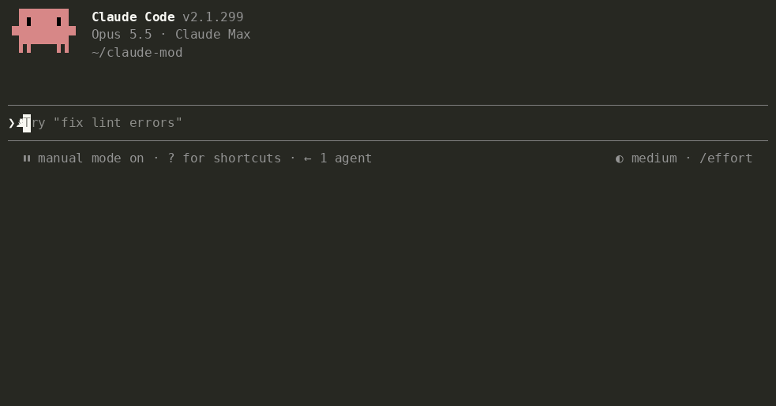

# Tidia — limpeza de ditado para o Claude Code

**Ditado organizado para a IA.** Fale à vontade. Envie um texto claro.

<!-- languages:start -->
[English](README.md) · [한국어](README.ko.md) · [日本語](README.ja.md) · [简体中文](README.zh.md) · [繁體中文](README.zh-TW.md) · [Español](README.es.md) · [Deutsch](README.de.md) · [Français](README.fr.md) · Português (Brasil) · [Русский](README.ru.md) · [हिन्दी](README.hi.md) · [Bahasa Indonesia](README.id.md)
<!-- languages:end -->



O Tidia (*TID-ee-a*) organiza o texto que o ditado integrado do Claude Code coloca no campo de entrada antes do envio. Funciona com `/voice` no terminal e com o botão de microfone no aplicativo para desktop.

- Remove vícios de linguagem («um», «음», «えーと»), repetições e começos abandonados; mantém a versão final após uma correção durante a fala.
- Recupera a grafia inglesa de termos transcritos foneticamente («리액트» → React, «깃 푸시» → git push) e a grafia real de arquivos e nomes da conversa.
- Preserva o conteúdo. Não responde, traduz nem resume. Se a limpeza falhar ou parecer errada, envia o original.

## Instalação

```
/plugin marketplace add fbwndrud/tidia
/plugin install tidia@tidia
```

Requer Claude Code 2.1.296 ou posterior. Testado no macOS; Linux e Windows ainda não foram testados. Para experimentar um clone sem instalar: `claude --plugin-dir /path/to/tidia`.

## Uso

Dite normalmente e pressione Enter. A versão organizada será enviada.

- Organiza uma vez, ao pressionar Enter: uma chamada ao modelo por mensagem. O envio espera alguns segundos. Uma pausa durante a fala não inicia a limpeza.
- `polish`, o padrão, escreve uma mensagem curta e clara e usa uma lista para vários pedidos. `minimal` só remove hesitações e mantém suas palavras: peça «mantenha minhas palavras e tire só as hesitações».
- O terminal e o desktop mostram a mensagem enviada. No desktop, ela permanece ao trocar de sessão ou reiniciar o aplicativo. `message_view` oferece três visualizações:

  | `tidied` (padrão) | `labeled` | `full` |
  |---|---|---|
  | Só o texto enviado | O que o Tidia fez + texto enviado | Ditado original + o que o Tidia fez + texto enviado |
  | «Mostre só o texto organizado» | «Mostre o tipo de organização» | «Mostre também o ditado original» |

  `labeled` e `full` indicam quando uma regra condicional foi aplicada. Peça ao Claude para mudar os rótulos com `bubble_labels`.
- Para organizar a cada pausa, peça «organize meu ditado sempre que eu parar de falar». A prévia aparece acima do campo e Enter a envia. Isso custa uma chamada por pausa, geralmente 2–4 por mensagem. A prévia não pode ser editada: se você mudar o campo, seu texto será enviado como foi editado, sem limpeza.
- Editar o campo antes do envio descarta a limpeza. Texto digitado nunca é organizado.
- Peça «mostre os detalhes da limpeza do ditado» para ver avisos e o motivo de um envio sem organização.

## Fale com o Claude

Você pode configurar tudo por voz:

- «Adicione Tailscale ao meu dicionário de voz.» / «Não, eu disse Tailscale.»
- «Mantenha minhas palavras, tire só as hesitações.» / «Desative a limpeza por enquanto.»
- «Quando eu relatar um bug, escreva o sintoma, os passos e o resultado esperado.»
- «Sempre envie meu ditado em uma lista numerada e um resumo de uma linha.» / «Use frases normais.»
- «Use um tom educado.» / «Minhas mensagens devem ser curtas e objetivas.»

O tom e o formato são regras de saída, aplicadas sempre ou quando uma condição é atendida. As sete regras iniciais —bugs, pedidos de funcionalidades, revisões, tarefas e tom educado, informal ou como falado— ficam desativadas até você pedir.

Quando identifica uma palavra mal reconhecida, o Claude a adiciona ao dicionário e avisa; «desfaça isso» a remove. Alterar entradas que ele não adicionou exige autorização. `dict_approval ask` faz perguntar antes de qualquer mudança. Regras e ajustes também pedem autorização, salvo se o modo de permissões do Claude Code já permitir as ferramentas do Tidia. Os ajustes antigos são migrados na primeira inicialização após uma atualização.


## Custo e privacidade

- **Uma chamada ao modelo por limpeza**, com sonnet por padrão: cerca de 1.000 tokens de instruções fixas mais aproximadamente o dobro do tamanho do ditado. Um ditado curto usa cerca de 1.000–1.500 tokens; um longo ou com várias regras, cerca de 2.000. Conta para o uso do Claude. Peça «use haiku para a limpeza» para reduzir tempo e custo.
- O ditado, até 300 caracteres do campo de cada lado, dicas de grafia do dicionário e das últimas mensagens, e as regras passam pela conexão Anthropic da sessão. `/tidia dict build` pede autorização e envia só palavras candidatas, em uma chamada. Não há outro servidor nem telemetria.
- O Tidia não processa áudio. Guarda localmente as últimas 50 mensagens organizadas, com o ditado e o texto enviado, para restaurar a visualização: sempre no desktop e no terminal com `labeled` ou `full`. Mensagens muito longas ficam só durante a sessão. Guarda também até 200 pares de correções, o dicionário e as impressões digitais dos últimos 200 textos enviados —hashes de 32 bits, não os textos— para não limpar novamente entradas recuperadas com ↑. Nenhum outro ditado é armazenado.
- O Claude recebe uma linha invisível na sua mensagem, com uma explicação fixa e o ditado original em JSON. Se você editou o resultado, ela informa que a mensagem expressa sua intenção e o ditado é só referência. Texto digitado e ditados sem mudanças não recebem essa linha. `attach_raw off` a desativa. Uma orientação curta é enviada uma vez por sessão e após uma compactação para interpretar essas linhas e gerenciar palavras e regras.

## Saiba mais

A [arquitetura](docs/architecture.md) e a [referência](docs/reference.md), em inglês, explicam o funcionamento, os comandos, os ajustes, o dicionário e as regras.

**Limites.** A extensão do VS Code não tem faixa e não mostra detalhes de depuração. Ditados com menos de três palavras ficam intactos. «Encurte» ou «envie» são tratados como texto, não como comandos. A perda de entonação pode transformar uma pergunta sem palavra interrogativa em afirmação; o Claude recebe o original para conferir.

**Idiomas.** Os README e as mensagens da interface estão disponíveis em 12 idiomas. `ui_language auto` segue o idioma do Claude Code; `/tidia set ui_language pt` seleciona português brasileiro. Idiomas não suportados usam inglês. A limpeza funciona em qualquer idioma que o Claude escreva. As verificações específicas de significado e o conjunto de avaliação ainda cobrem oito idiomas: coreano, inglês, japonês, chinês, espanhol, alemão, francês e português (162 de 164 casos em uma execução com sonnet). As novas traduções não ampliam essa validação.

**Algo foi limpo errado?** [Abra uma issue](https://github.com/fbwndrud/tidia/issues/new?template=cleanup.yml) com o que você disse e o que foi enviado. Cada relato vira um caso de teste.

## Desenvolvimento

```bash
claude plugin test .
claude plugin validate --strict .
npx -y -p typescript@5.6.3 tsc -p .
```

A verificação de tipos lê as declarações do motor em `.claude-plugin/types/`, criadas no primeiro carregamento com `claude --plugin-dir .`. Confira os ajustes com `bun scripts/check-settings.ts` e os links das traduções com `python3 scripts/check-translations.py`.

`eval/` contém 164 ditados em oito idiomas, escritos por IA, lidos pela síntese de voz do Mac e transcritos pelo reconhecimento de voz do Mac. `python3 -I eval/run.py` os organiza com o modelo real. [EVAL.md](EVAL.md) explica o método e os limites; as [verificações manuais](docs/manual-checks.md) cobrem testes de microfone.

## Licença

MIT
