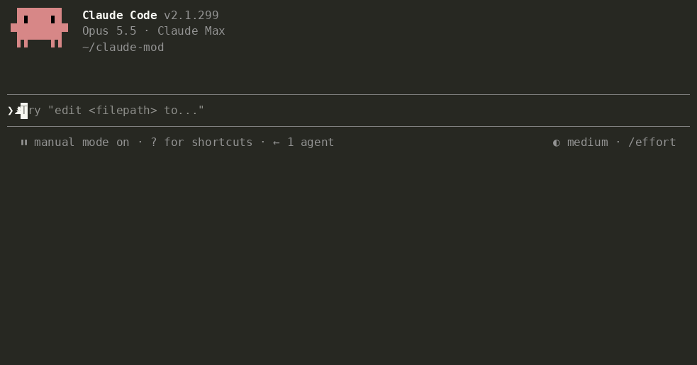

# Tidia — очистка голосового ввода для Claude Code

**Чёткий текст для ИИ.** Говорите свободно. Отправляйте понятно.

[](https://github.com/fbwndrud/tidia/releases/latest) [](https://code.claude.com/) [](LICENSE)

<!-- languages:start -->
[English](README.md) · [한국어](README.ko.md) · [日本語](README.ja.md) · [简体中文](README.zh.md) · [繁體中文](README.zh-TW.md) · [Español](README.es.md) · [Deutsch](README.de.md) · [Français](README.fr.md) · [Português (Brasil)](README.pt-BR.md) · Русский · [हिन्दी](README.hi.md) · [Bahasa Indonesia](README.id.md)
<!-- languages:end -->

[Установка](#install) · [Использование](#use) · [Обращайтесь к Claude](#voice-settings) · [Стоимость и конфиденциальность](#privacy) · [Подробнее](#help)

Tidia (*TID-ee-a*) очищает текст, который встроенная диктовка Claude Code вводит в поле запроса, перед отправкой. Работает с `/voice` в терминале и кнопкой микрофона в настольном приложении.

- Удаляет слова-паразиты («эм», «ну», «um», «음»), повторы и отброшенные начала фраз, оставляя окончательный вариант после исправления на ходу.
- Возвращает английское написание терминам, записанным по звучанию («риакт» → React, «깃 푸시» → git push), и использует точное написание файлов и имён из беседы.
- Сохраняет содержание. Не отвечает, не переводит и не пересказывает. Если обработка не удалась или результат выглядит неверно, отправляется оригинал.

<a id="install"></a>

## Установка

Требуется **Claude Code 2.1.296 или новее**. Проверено на macOS; Linux и Windows пока не проверены.

Выполните эту строку в **терминале**, вне разговора с Claude:

```bash
claude plugin install tidia --marketplace fbwndrud/tidia
```

Установка для вашего пользователя во всех проектах. Перезапустите Claude Code или откройте новый сеанс Code в приложении и проверьте `/tidia`. Отдельный ключ API не нужен.

<details>
<summary>Другие способы установки</summary>

В разговоре Claude Code выполните строки по очереди и выберите **Install for you**:

```text
/plugin marketplace add fbwndrud/tidia
/plugin install tidia@tidia
```

Только в этом репозитории: добавьте `--scope local` к команде терминала. Пробный запуск из клона: `claude --plugin-dir /path/to/tidia`.

[Claude Code · plugin installation](https://code.claude.com/docs/en/plugins/install#add-a-marketplace-and-install-in-one-command)

</details>

### Обновить

Выполните в терминале, затем перезапустите Claude Code:

```bash
claude plugin marketplace update tidia
claude plugin update tidia@tidia
```

Автообновление: `/plugin` → **Marketplaces** → **tidia** → **Enable auto-update**. Для сторонних каталогов оно по умолчанию выключено.

<details>
<summary>Удалить</summary>

```bash
claude plugin uninstall tidia@tidia
```

</details>

<a id="use"></a>

## Использование

Для начала включите `/voice` в терминале или нажмите микрофон во вкладке **Code** приложения. Говорите и отправляйте сообщение; дополнительные настройки не нужны.

Диктуйте как обычно и нажмите Enter. Будет отправлен обработанный текст.



<details>
<summary>Стили, отображение и предпросмотр при паузах</summary>

- Обработка запускается один раз, при Enter: один вызов модели на сообщение. Отправка ждёт несколько секунд. Пауза в речи не запускает обработку.
- Стандартный стиль `polish` переписывает текст коротко и ясно, а несколько просьб оформляет списком. `minimal` убирает только слова-паразиты и сохраняет ваши формулировки: «Оставляй мои слова, убирай только слова-паразиты».
- Терминал и настольное приложение показывают отправленный текст. В настольном приложении он сохраняется при смене сеанса и перезапуске. `message_view` предлагает три вида:

  | `tidied` (по умолчанию) | `labeled` | `full` |
  |---|---|---|
  | Только отправленный текст | Вид обработки + отправленный текст | Исходная диктовка + вид обработки + отправленный текст |
  | «Показывай только обработанный текст» | «Показывай вид обработки» | «Показывай и исходную диктовку» |

  В `labeled` и `full` также отмечается применение условного правила. Попросите Claude изменить подписи через `bubble_labels`.
- Для обработки после каждой паузы скажите: «Обрабатывай диктовку каждый раз, когда я перестаю говорить». Предпросмотр появляется над полем, Enter отправляет его. Это один вызов модели на паузу, обычно 2–4 на сообщение. Предпросмотр нельзя редактировать: если изменить поле, отправится ваш изменённый текст без обработки.
- Ручная правка поля перед отправкой отменяет обработку. Набранный текст никогда не обрабатывается.
- «Показывай подробности обработки диктовки» включает уведомления и причины отправки без обработки.

</details>

<a id="voice-settings"></a>

## Обращайтесь к Claude

Настройки можно менять голосом:

- «Добавь Tailscale в мой голосовой словарь». / «Нет, я сказал Tailscale».
- «Оставляй мои слова, убирай только слова-паразиты». / «Пока выключи обработку».
- «При описании ошибки записывай симптом, шаги воспроизведения и ожидаемый результат».
- «Всегда оформляй диктовку нумерованным списком и добавляй итог одной строкой». / «Пиши обычными предложениями».
- «Используй вежливый тон». / «Мои сообщения должны быть короткими и деловыми».

<details>
<summary>Правила вывода и разрешения словаря</summary>

Тон и формат хранятся в правилах вывода. Каждое применяется всегда или только при выполнении условия. Семь начальных правил —ошибки, запросы функций, ревью, задачи и вежливый, разговорный или исходный тон— выключены, пока вы не попросите их включить.

Когда Claude уверен, что слово распознано неверно, он добавляет его в словарь и сообщает одной строкой; «отмени это» удаляет его. Изменение записей, добавленных не им, требует разрешения. `dict_approval ask` заставляет спрашивать перед каждым изменением словаря. Правила и настройки тоже требуют разрешения, если режим прав Claude Code ещё не разрешил инструменты Tidia. Старые настройки переносятся при первом запуске после обновления.


</details>

<a id="privacy"></a>

## Стоимость и конфиденциальность

Каждая очистка — один вызов модели через ваше подключение Claude, по умолчанию при отправке. Аудио не обрабатывается, телеметрии нет; последние расшифровки и настройки хранятся локально.

<details>
<summary>Стоимость токенов, сохранённые данные и информация для Claude</summary>

- **Один вызов модели на обработку**, по умолчанию sonnet: около 1 000 токенов фиксированных инструкций плюс примерно удвоенная длина диктовки. Короткое сообщение использует 1 000–1 500 токенов, длинное или несколько правил — около 2 000. Это учитывается в расходе Claude. «Используй haiku для обработки» уменьшает время и стоимость.
- Диктовка, до 300 символов поля с каждой стороны, подсказки написания из словаря и последних сообщений, а также правила отправляются через соединение Anthropic текущего сеанса. `/tidia dict build` спрашивает разрешение и отправляет только слова-кандидаты одним вызовом. Других серверов и телеметрии нет.
- Tidia не обрабатывает аудио. Локально хранятся последние 50 обработанных сообщений —диктовка и отправленный текст— для восстановления вида: всегда в настольном приложении, в терминале с `labeled` или `full`. Очень длинные сообщения сохраняются лишь до конца сеанса. Также хранятся до 200 пар исправлений, словарь и отпечатки последних 200 отправленных запросов —32-битные хеши, а не тексты—, чтобы не обрабатывать повторно запросы, вызванные клавишей ↑. Другие диктовки не сохраняются.
- Claude получает невидимую в вашем сообщении строку: фиксированное пояснение и исходную диктовку в JSON. Если вы отредактировали результат, строка указывает, что сообщение выражает ваше намерение, а диктовка нужна лишь для справки. Набранные сообщения и неизменённые диктовки этой строки не получают. `attach_raw off` отключает её. Раз в сеанс и после сжатия контекста Claude получает краткую инструкцию по чтению строк и работе со словами и правилами.

</details>

<a id="help"></a>

## Подробнее

[Архитектура](docs/architecture.md) и [справочник](docs/reference.md), на английском, описывают устройство, команды, настройки, словарь и правила.

<details>
<summary>Совместимость, языки и ограничения</summary>

**Ограничения.** В расширении VS Code нет панели, поэтому подробности отладки не отображаются. Диктовки короче трёх слов не меняются. «Сделай короче» и «отправь» обрабатываются как текст, а не команды. Распознавание теряет интонацию, поэтому вопрос без вопросительного слова может стать утверждением; Claude получает оригинал для проверки.

**Языки.** README и сообщения интерфейса доступны на 12 языках. `ui_language auto` следует языку Claude Code; `/tidia set ui_language ru` выбирает русский. Неподдерживаемые языки используют английский. Обработка работает на любом языке, на котором пишет Claude. Языковые проверки смысла и набор оценки по-прежнему охватывают восемь языков: корейский, английский, японский, китайский, испанский, немецкий, французский и португальский (162 из 164 случаев в одном запуске с sonnet). Новые переводы не расширяют эту проверку.

</details>

**Ошибка обработки?** [Создайте issue](https://github.com/fbwndrud/tidia/issues/new?template=cleanup.yml) с тем, что вы сказали и что было отправлено. Каждый отчёт становится тестом.

<a id="development"></a>

## Разработка

<details>
<summary>Проверки и оценка для разработчиков</summary>

```bash
claude plugin test .
claude plugin validate --strict .
npx -y -p typescript@5.6.3 tsc -p .
```

Проверка типов читает объявления движка из `.claude-plugin/types/`, создаваемые при первом запуске `claude --plugin-dir .`. Согласованность настроек проверяется командой `bun scripts/check-settings.ts`, ссылки переводов — `python3 scripts/check-translations.py`.

В `eval/` находятся 164 диктовки на восьми языках: тексты ИИ, озвученные синтезатором Mac и записанные его распознаванием речи. `python3 -I eval/run.py` обрабатывает их настоящей моделью. [EVAL.md](EVAL.md) описывает метод и ограничения; [ручные проверки](docs/manual-checks.md) — испытания микрофона.

</details>

<a id="license"></a>

## Лицензия

MIT
