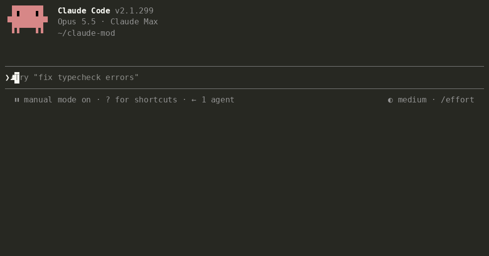

# Tidia — 為 Claude Code 整理語音輸入

**為 AI 整理口述文字。** 自由說，清楚傳。

[](https://github.com/fbwndrud/tidia/releases/latest) [](https://code.claude.com/) [](LICENSE)

<!-- languages:start -->
[English](README.md) · [한국어](README.ko.md) · [日本語](README.ja.md) · [简体中文](README.zh.md) · 繁體中文 · [Español](README.es.md) · [Deutsch](README.de.md) · [Français](README.fr.md) · [Português (Brasil)](README.pt-BR.md) · [Русский](README.ru.md) · [हिन्दी](README.hi.md) · [Bahasa Indonesia](README.id.md)
<!-- languages:end -->

[安裝](#install) · [使用](#use) · [與 Claude 對話](#voice-settings) · [費用與隱私](#privacy) · [更多資訊](#help)

Tidia（讀作 *TID-ee-a*）在傳送前，整理 Claude Code 內建語音輸入寫入提示欄的文字。支援終端機的 `/voice` 和桌面應用程式的麥克風按鈕。

- 移除「嗯」「那個」「um」「음」等贅詞、重複和放棄的開頭；中途改口後，只保留最後表達的內容。
- 將依發音轉寫的英文術語還原成英文拼字（「리액트」→ React、「깃 푸시」→ git push），並使用對話中檔案和名稱的實際寫法。
- 保留你的意思，不回答、翻譯或摘要。整理失敗或結果不合適時，傳送原文。

<a id="install"></a>

## 安裝

需要 **Claude Code 2.1.296 或更新版本**。已在 macOS 上測試；Linux 和 Windows 尚未測試。

在**終端機**執行以下一行，而不是在 Claude 對話中：

```bash
claude plugin install tidia --marketplace fbwndrud/tidia
```

安裝至目前使用者的所有專案。重新啟動 Claude Code，或在桌面應用程式開啟新的 Code 工作階段，再用 `/tidia` 確認已啟用。不需要額外的 API 金鑰。

<details>
<summary>其他安裝方式</summary>

在 Claude Code 對話中逐行執行，然後選擇 **Install for you**：

```text
/plugin marketplace add fbwndrud/tidia
/plugin install tidia@tidia
```

僅限目前儲存庫：在終端機安裝指令後加 `--scope local`。從複製的資料夾試用：`claude --plugin-dir /path/to/tidia`。

[Claude Code · plugin installation](https://code.claude.com/docs/en/plugins/install#add-a-marketplace-and-install-in-one-command)

</details>

### 更新

在終端機執行，然後重新啟動 Claude Code：

```bash
claude plugin marketplace update tidia
claude plugin update tidia@tidia
```

自動更新：`/plugin` → **Marketplaces** → **tidia** → **Enable auto-update**。第三方市集預設不會自動更新。

<details>
<summary>移除</summary>

```bash
claude plugin uninstall tidia@tidia
```

</details>

<a id="use"></a>

## 使用

首次使用：在終端機啟用 `/voice`，或按桌面應用程式 **Code** 分頁的麥克風。說話後傳送訊息即可，不需要額外設定。

照常口述，按 Enter 後傳送整理好的版本。


<details>
<summary>整理風格、訊息顯示與暫停預覽</summary>

- 按 Enter 時只整理一次，每則訊息呼叫一次模型，傳送會等待幾秒。說話中途停頓不會觸發整理。
- 預設 `polish` 改寫成簡短清楚的訊息，將多個請求列成清單。`minimal` 只移除贅詞，保留你的措辭。可以告訴 Claude：「保留我的原話，只刪掉贅詞。」
- 終端機與桌面顯示實際傳送的文字。桌面在切換工作階段或重新啟動後仍保留此顯示。`message_view` 有三種檢視：

  | `tidied`（預設） | `labeled` | `full` |
  |---|---|---|
  | 只顯示傳送的文字 | 整理方式 + 傳送的文字 | 口述原文 + 整理方式 + 傳送的文字 |
  | 「只顯示整理後的文字」 | 「顯示整理方式」 | 「也顯示我的口述原文」 |

  `labeled` 與 `full` 會標明是否套用了附帶條件的輸出規則。顯示的標籤可請 Claude 透過 `bubble_labels` 修改。
- 要在每次停頓時整理，可以說「每次我停止說話就整理」。預覽顯示在輸入欄上方，按 Enter 即傳送。每次停頓呼叫一次模型，通常每則訊息 2–4 次。預覽不可編輯：修改輸入欄後，會依你修改的原樣傳送，不再整理。
- 傳送前手動編輯輸入欄會捨棄整理結果。鍵盤輸入的文字不會整理。
- 說「顯示語音整理的詳細資訊」，可查看通知與未整理就傳送的原因。

</details>

<a id="voice-settings"></a>

## 與 Claude 對話

不必逐項手動設定，可以直接說：

- 「把 Tailscale 加進語音字典。」／「不是，我說的是 Tailscale。」
- 「保留我的措辭，只刪掉贅詞。」／「暫時關閉語音整理。」
- 「回報 bug 時，依症狀、重現步驟、預期結果來寫。」
- 「總是把口述寫成編號清單，最後加一句總結。」／「用一般句子寫。」
- 「用禮貌的語氣。」／「我的訊息要簡短直接。」

<details>
<summary>輸出規則與字典權限</summary>

語氣和格式都屬於輸出規則，可以一律套用，也可以只在符合條件時套用。七條初始規則（bug 回報、功能請求、審查、工作清單，以及禮貌、輕鬆或保留口述語氣）預設關閉，直到你要求啟用。

Claude 能確定某個詞被錯誤辨識時，會自行加入字典並用一行通知你；說「復原」可刪除。修改不是由 Claude 新增的項目時會先詢問。`dict_approval ask` 要求每次修改字典都先詢問。修改規則與設定也會詢問，除非 Claude Code 的權限模式已允許 Tidia 工具。舊版設定會在升級後的首次啟動時移轉。



</details>

<a id="privacy"></a>

## 費用與隱私

每次整理透過既有的 Claude 連線呼叫模型一次，預設在傳送時整理一次。不處理音訊、不蒐集遙測；近期原文和設定儲存在本機。

<details>
<summary>Token 費用、儲存資料與傳給 Claude 的資訊</summary>

- **每次整理呼叫一次模型**，預設 sonnet。固定指示約 1,000 個 token，加上約兩倍口述長度；短輸入約 1,000–1,500 個 token，長輸入或多條規則約 2,000 個。計入一般 Claude 用量。說「整理時用 haiku」可降低延遲與費用。
- 口述文字、口述部分前後各最多 300 個字元、字典和最近對話中的檔案及識別名稱拼字提示、輸出規則，透過目前工作階段的 Anthropic 連線傳送。`/tidia dict build` 先詢問，只將候選詞傳送一次。沒有其他伺服器或遙測。
- 不處理音訊。為還原顯示，會在本機儲存最近 50 則整理訊息的原文與傳送文字：桌面一律使用，終端機在 `labeled` 或 `full` 時使用。特別長的訊息只在工作階段期間保留。也儲存最多 200 組學到的詞語更正、字典，以及最近 200 則已傳送提示的指紋（32 位元雜湊，不是文字），避免用 ↑ 叫回的提示再次整理。不儲存其他口述。
- Claude 會收到一行不顯示在你的訊息中的內容：固定說明和 JSON 格式的口述原文。若你手動編輯了結果，會說明訊息是你的真正意圖，原文只作參考。鍵盤輸入和未變更的口述不附加這行。`attach_raw off` 可關閉。每個工作階段及壓縮後各一次，用簡短指南說明如何閱讀，以及何時新增詞語或規則。

</details>

<a id="help"></a>

## 更多資訊

英文[架構說明](docs/architecture.md)與[參考文件](docs/reference.md)介紹運作原理、指令、設定、字典與輸出規則。

<details>
<summary>相容性、語言與限制</summary>

**限制。** VS Code 擴充功能沒有提示帶，無法顯示除錯詳情。少於三個詞的輸入保留原樣。「再短一點」「傳送」等口述指令當作文字整理，不執行。語音辨識會遺失語調，沒有疑問詞的問題可能被整理成陳述；Claude 會收到原文並被要求檢查。

**語言。** README 與介面訊息支援 12 種語言。`ui_language auto` 跟隨 Claude Code 的語言設定；`/tidia set ui_language zh-TW` 指定繁體中文。`zh-TW`、`zh-Hant`、`zh-HK` 會自動選用繁體。不支援的語言使用英文。整理本身適用於 Claude 能書寫的任何語言。語言專屬的語意檢查與評估集仍涵蓋八種語言：韓語、英語、日語、中文、西班牙語、德語、法語、葡萄牙語（sonnet 一次執行，164 例中 162 例通過）。新增翻譯並不擴大這項驗證。

</details>

**整理有誤？** 請附上說出的內容與傳送的內容[回報問題](https://github.com/fbwndrud/tidia/issues/new?template=cleanup.yml)。每個回報都會成為測試案例。

<a id="development"></a>

## 開發

<details>
<summary>開發檢查與評估</summary>

```bash
claude plugin test .
claude plugin validate --strict .
npx -y -p typescript@5.6.3 tsc -p .
```

型別檢查讀取 `.claude-plugin/types/` 中的引擎宣告，首次以 `claude --plugin-dir .` 載入時產生。用 `bun scripts/check-settings.ts` 檢查設定一致性，用 `python3 scripts/check-translations.py` 檢查翻譯連結。

`eval/` 包含八種語言的 164 條口述：AI 編寫腳本，Mac 語音合成朗讀，再由 Mac 語音辨識轉寫。`python3 -I eval/run.py` 使用真實模型整理。[EVAL.md](EVAL.md)說明方法與侷限，[手動檢查](docs/manual-checks.md)列出麥克風測試。

</details>

<a id="license"></a>

## 授權

MIT
