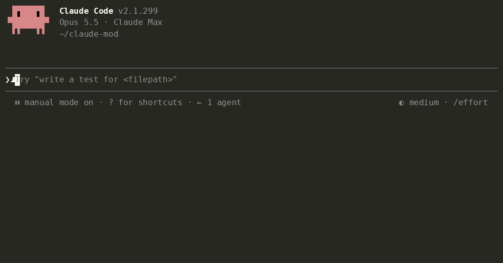

# Tidia — 为 Claude Code 整理语音输入

**为 AI 整理口述文字。** 随意说，清楚发。

<!-- languages:start -->
[English](README.md) · [한국어](README.ko.md) · [日本語](README.ja.md) · 简体中文 · [繁體中文](README.zh-TW.md) · [Español](README.es.md) · [Deutsch](README.de.md) · [Français](README.fr.md) · [Português (Brasil)](README.pt-BR.md) · [Русский](README.ru.md) · [हिन्दी](README.hi.md) · [Bahasa Indonesia](README.id.md)
<!-- languages:end -->


Tidia（读作 *TID-ee-a*）在发送前，整理 Claude Code 内置语音输入写入提示框的文字。支持终端的 `/voice` 和桌面应用的麦克风按钮。

- 去掉“嗯”“那个”“um”“음”等口头语、重复和废弃的开头；中途改口后，只保留最终表达的内容。
- 将按发音转写的英文术语还原为英文拼写（“리액트” → React，“깃 푸시” → git push），并按实际写法拼写对话中的文件和名称。
- 保留你的意思，不回答、翻译或概括。整理失败或结果不合适时，发送原文。

## 安装

```
/plugin marketplace add fbwndrud/tidia
/plugin install tidia@tidia
```

需要 Claude Code 2.1.296 或更高版本。已在 macOS 上测试；Linux 和 Windows 尚未测试。不安装也可从克隆目录试用：`claude --plugin-dir /path/to/tidia`。

## 使用

照常口述，按 Enter 后发送整理好的版本。

- 按 Enter 时只整理一次，每条消息调用一次模型，发送会等待几秒。说话中途停顿不会触发整理。
- 默认 `polish` 改写为简短清晰的消息，多个请求写成列表。`minimal` 只去掉口头语，保留你的措辞。可以告诉 Claude：“保留我的原话，只去掉口头语。”
- 终端和桌面显示实际发送的文字。桌面在切换会话或重启后仍保留该显示。`message_view` 有三种视图：

  | `tidied`（默认） | `labeled` | `full` |
  |---|---|---|
  | 只显示发送的文字 | 整理方式 + 发送的文字 | 口述原文 + 整理方式 + 发送的文字 |
  | “只显示整理后的文字” | “显示整理方式” | “也显示我的口述原文” |

  `labeled` 和 `full` 会标明是否应用了带条件的输出规则。显示的标签可以让 Claude 通过 `bubble_labels` 修改。
- 要在每次停顿时整理，可以说“每次我停止说话就整理”。预览显示在输入框上方，按 Enter 即发送。每次停顿调用一次模型，通常每条消息 2–4 次。预览不可编辑：修改输入框后，会按你修改的原样发送，不再整理。
- 发送前手动编辑输入框会丢弃整理结果。键盘输入的文字从不整理。
- 说“显示语音整理的详细信息”，可查看通知和未整理就发送的原因。

## 与 Claude 对话

不必逐项手动设置，可以直接说：

- “把 Tailscale 加进语音词典。”／“不，我说的是 Tailscale。”
- “保留我的措辞，只去掉口头语。”／“暂时关闭语音整理。”
- “报告 bug 时，按症状、复现步骤、预期结果来写。”
- “总是把口述写成编号列表，最后加一句总结。”／“用普通句子写。”
- “用礼貌的语气。”／“我的消息要简短直接。”

语气和格式都属于输出规则，可以始终应用，也可以只在满足条件时应用。七条初始规则（bug 报告、功能请求、评审、任务列表，以及礼貌、随意或保留口述语气）默认关闭，直到你要求启用。

Claude 能确定某个词被错误识别时，会自行加入词典并用一行通知你；说“撤销”可删除。修改不是由 Claude 添加的词条时会先询问。`dict_approval ask` 要求每次修改词典都先询问。修改规则和设置也会询问，除非 Claude Code 的权限模式已允许 Tidia 工具。旧版设置会在升级后的首次启动时迁移。



## 费用与隐私

- **每次整理调用一次模型**，默认 sonnet。固定指令约 1,000 个 token，加上约两倍口述长度；短输入约 1,000–1,500 个 token，长输入或多条规则约 2,000 个。计入正常 Claude 用量。说“整理时用 haiku”可降低延迟和费用。
- 口述文字、口述部分前后各最多 300 个字符、词典和最近对话中的文件及标识符拼写提示、输出规则，经当前会话的 Anthropic 连接发送。`/tidia dict build` 先询问，只将候选词发送一次。没有其他服务器或遥测。
- 不处理音频。为恢复显示，会在本机保存最近 50 条整理消息的原文与发送文字：桌面始终使用，终端在 `labeled` 或 `full` 时使用。特别长的消息仅在会话期间保留。还保存最多 200 对学习到的词语纠正、词典，以及最近 200 条已发送提示的指纹（32 位哈希，不是文字），避免用 ↑ 调回的提示再次整理。不保存其他口述。
- Claude 会收到一行不显示在你的消息中的内容：固定说明和 JSON 格式的口述原文。如果你手动编辑了结果，会说明消息是你的真实意图，原文只作参考。键盘输入和未改变的口述不附加这行。`attach_raw off` 可关闭。每个会话及压缩后各一次，用简短指南说明如何阅读及何时添加词语或规则。

## 更多信息

英文[架构说明](docs/architecture.md)和[参考文档](docs/reference.md)介绍工作原理、命令、设置、词典与输出规则。

**限制。** VS Code 扩展没有提示带，无法显示调试详情。少于三个词的输入保留原样。“再短一点”“发送”等口述命令作为文字整理，不执行。语音识别丢失语调，没有疑问词的问题可能被整理成陈述；Claude 会收到原文并被要求检查。

**语言。** README 和界面消息支持 12 种语言。`ui_language auto` 跟随 Claude Code 的语言设置；`/tidia set ui_language zh` 指定简体中文，`/tidia set ui_language zh-TW` 指定繁体中文。不支持的语言使用英语。整理本身适用于 Claude 能书写的任何语言。语言专项的意义检查和评估集仍覆盖八种语言：韩语、英语、日语、中文、西班牙语、德语、法语、葡萄牙语（sonnet 一次运行，164 例中 162 例通过）。新增翻译并不扩大这项验证。

**整理有误？** 请附上说出的内容和发送的内容[提交问题](https://github.com/fbwndrud/tidia/issues/new?template=cleanup.yml)。每个报告都会成为测试用例。

## 开发

```bash
claude plugin test .
claude plugin validate --strict .
npx -y -p typescript@5.6.3 tsc -p .
```

类型检查读取 `.claude-plugin/types/` 中的引擎声明，首次用 `claude --plugin-dir .` 加载时生成。用 `bun scripts/check-settings.ts` 检查设置一致性，用 `python3 scripts/check-translations.py` 检查翻译链接。

`eval/` 包含八种语言的 164 条口述：AI 编写脚本，Mac 语音合成朗读，再由 Mac 语音识别转写。`python3 -I eval/run.py` 用真实模型整理。[EVAL.md](EVAL.md)说明方法和局限，[手动检查](docs/manual-checks.md)列出麦克风测试。

## 许可证

MIT
