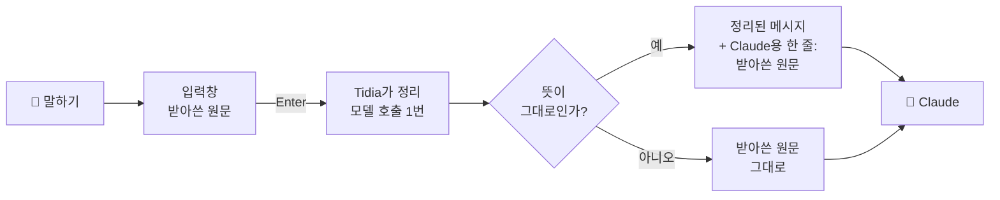
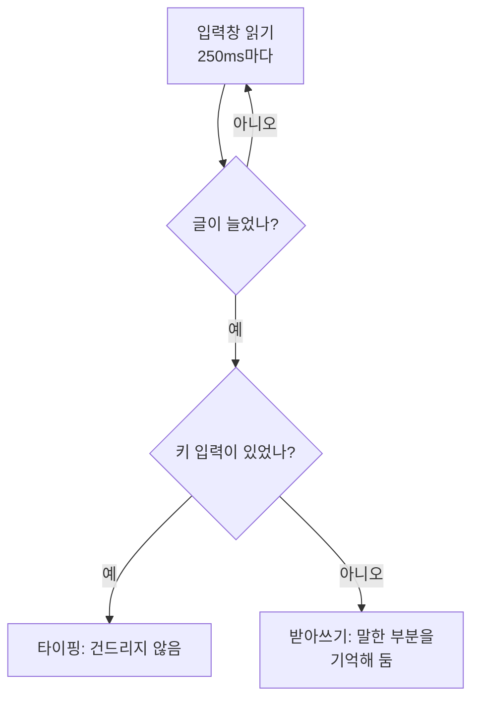
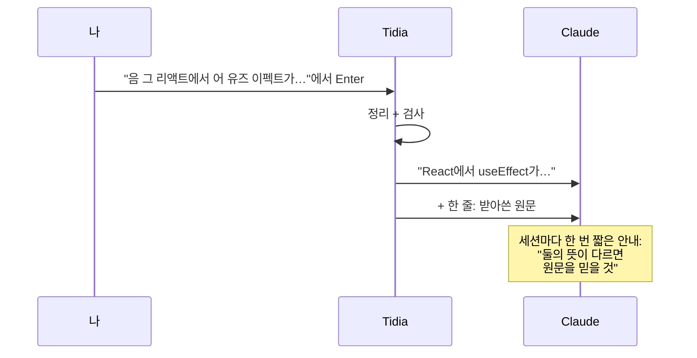
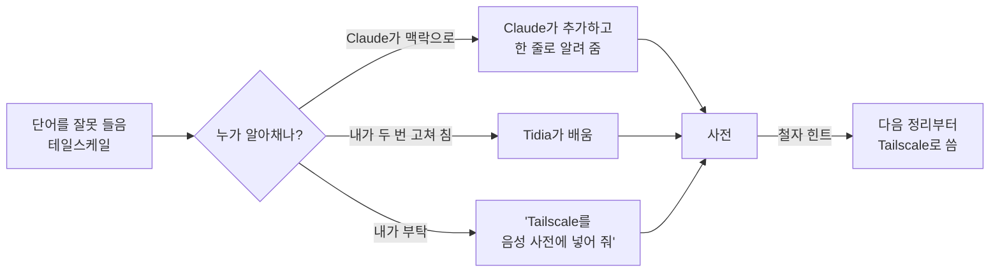

# Tidia는 이렇게 동작합니다

[English](architecture.md)

## 한 장으로 보기

Tidia는 마이크와 Claude 사이에 서 있는 꼼꼼한 친구라고 생각하면 됩니다. 말하면 마이크가 들은 대로 입력창에 적고, Enter를 누르면 친구가 그걸 재빨리 깔끔하게 다시 씁니다. 넘기기 전에 다시 쓴 글이 여전히 내가 한 말과 같은 뜻인지 확인하고, 조금이라도 이상하면 원래 말을 그대로 보냅니다.



Tidia는 소리를 듣지 않습니다. Claude Code의 받아쓰기가 입력창에 적은 글만 봅니다.

## 단계별로 보기

### 1. 말인지 타이핑인지 구분하기

Claude Code는 "이 글은 마이크에서 왔다"고 알려 주지 않습니다. 그래서 Tidia가 지켜봅니다. 0.25초마다 입력창을 읽는데, 타이핑은 키 입력 이벤트가 생기고 마이크는 생기지 않습니다. 키 입력 없이 세 단어 이상 늘어난 글이 받아쓰기입니다. 타이핑은 절대 정리하지 않습니다.



말한 부분만 정리합니다. 그 앞뒤에 직접 친 글은 그대로 둡니다.

### 2. Enter에서 딱 한 번 정리

Enter를 누르면 Tidia가 몇 초 동안 전송을 잡아 두고 모델(기본 sonnet)에게 말한 부분을 정리해 달라고 합니다. 받아쓰기와 함께 보내는 것:

- 앞뒤로 최대 300자의 입력창 내용. 주변 문장에 맞게 정리하려고;
- 철자 힌트: 내 사전, 그리고 최근 몇 메시지에 나온 파일 이름과 식별자;
- 내 출력 규칙. 예: "버그 얘기는 증상, 재현 방법, 기대 결과로".

모델은 군말과 말 더듬은 부분을 지우고, 말하다 고친 경우 고친 쪽만 남기고, 소리 나는 대로 적힌 영어를 영어로 되돌리고("리액트" → React), 규칙을 적용합니다. 대답하거나 번역하거나 요약하지 않습니다.

### 3. 안전 검사

모델도 틀릴 수 있어서, 보내기 전에 모든 정리 결과를 일반 코드로 짠 검사에 통과시킵니다:

| 검사 | 잡는 것 |
|---|---|
| empty | 아무것도 안 돌아옴 |
| negation | "해 줘"가 "하지 마"로, 또는 그 반대로 바뀜 |
| answer | 긴 요청이 두 단어짜리 대답으로 돌아옴 |
| script | 번역됐거나 글자가 깨져서 돌아옴 |
| length | 말한 것보다 지나치게 짧거나 김 |
| overlap | 내가 한 말이 너무 적게 남음 |
| added | 하지 않은 말이나 줄을 지어냄 |

하나라도 걸리면 원문을 보냅니다. 부정 검사는 8개 언어(한국어, 영어, 일본어, 중국어, 스페인어, 독일어, 프랑스어, 포르투갈어)를 알고, 나머지 검사는 언어와 상관없이 동작합니다.

### 4. Claude가 받는 것



정리된 메시지 하나에 Claude가 받는 건 딱 두 가지입니다.

**1. 메시지.** 채팅 화면에 보이는 그대로:

```text
React에서 useEffect가 두 번 실행돼. 개발 모드에서만 그래. 왜 그런지 한 줄로 알려 줘.
```

**2. 옆에 붙는 한 줄.** Claude는 보고, 내 메시지 화면에는 안 보입니다. 정해진 안내 문장 하나와 받아쓴 원문(JSON 문자열)만 들어 있고, 설정, 규칙, 사전은 들어 있지 않습니다. Claude에게 가는 글이라 영어입니다:

```text
[tidia] Dictated by voice and tidied before sending; where the meaning differs, this raw transcript is what the user said (JSON): "음 그러니까 리액트에서 유즈 이펙트가 어 두 번 실행되는데 아 아니 개발 모드에서만 그래 왜 그런지 한 줄로 알려 줘"
```

뜻: "음성으로 받아써서 보내기 전에 정리함. 뜻이 다른 곳은 이 원문이 사용자가 실제로 한 말."

보내기 전에 정리본을 직접 고쳤다면 문장이 `Dictated by voice, tidied, then edited by hand: the message above is what the user meant. Raw transcript, for reference (JSON): …`로 바뀝니다(뜻: 정리 후 손으로 고침, 메시지가 사용자가 뜻한 것, 원문은 참고용). 타이핑한 메시지와 바뀐 게 없는 받아쓰기에는 붙지 않습니다. `attach_raw off`로 끌 수 있습니다.

왜 보내나: 말은 억양이 사라져서 질문이 단정문으로 정리될 수 있고, 정리가 틀릴 수도 있습니다. 원문이 옆에 있으면 Claude가 실제로 한 말을 확인하고, 양쪽으로 읽히면 되묻습니다. 세션마다 한 번(압축 뒤에도 한 번) 가는 짧은 안내가 바로 이걸 알려 주고, 잘못 알아들은 단어를 사전에 넣거나 규칙을 제안할 때도 알려 줍니다.

### 5. 쓸수록 나아지기



규칙도 같습니다. 받아쓴 메시지를 어떻게 쓰고 싶은지 말하면 Claude가 규칙을 제안하고, 대화상자에서 허용하면 됩니다.

## 내 컴퓨터에 남는 것

모두 내 컴퓨터의 mod 전용 저장소에 있습니다:

- 최근 정리한 메시지 50개(말한 것, 보낸 것). 재시작해도 똑같이 보이게;
- 내 사전과 배운 단어 쌍 최대 200개;
- 내 출력 규칙.

오디오도, 다른 서버도, 텔레메트리도 없습니다. 네트워크 호출은 정리 자체 하나뿐이고, 세션의 Anthropic 연결을 그대로 씁니다.

## 코드 지도

| 위치 | 하는 일 |
|---|---|
| `hooks/register.ts` | 전부를 Claude Code에 연결: 입력창 감시, Enter에서 정리, 원문 메모 첨부, 메시지 표시, `/tidia`와 Claude용 도구 3개 등록. |
| `src/detector.ts` | 입력창의 글이 받아쓰기인지 판단. |
| `src/segment.ts`, `src/diff.ts` | 말한 부분과 바뀐 부분 찾기. |
| `src/cleaner.ts` | 모델 요청을 만들고 답을 읽음. |
| `src/guard.ts` | 위의 안전 검사. |
| `src/rules.ts` | 출력 규칙과 기본 제공 규칙 7개. |
| `src/dict/` | 사전, 내 수정에서 배우기, 발음 비슷한 말 맞추기, `/tidia dict build`. |
| `src/language.ts`, `src/tokens.ts` | 언어별 문자 체계와 단어 세기. |
| `src/ui/` | 입력창 위 밴드, 메시지 줄, 사전 창. |
| `src/config.ts`, `src/settings.ts`, `src/migrate.ts` | 설정, `/tidia set`, 옛 버전 설정 옮기기. |
| `src/i18n.ts` | 12개 언어 인터페이스 문구. 추가 번역은 `src/locales/`. |
