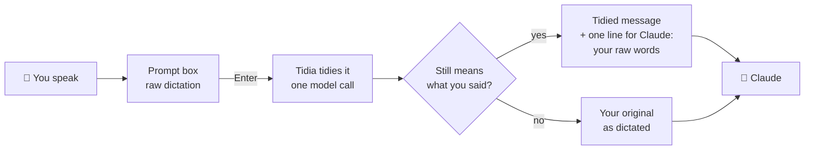
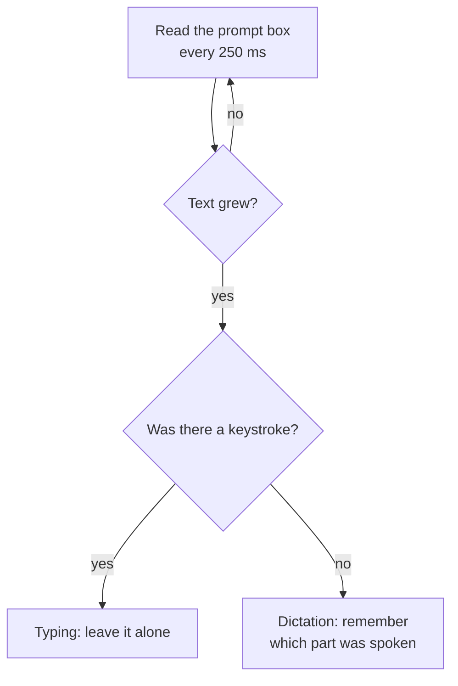
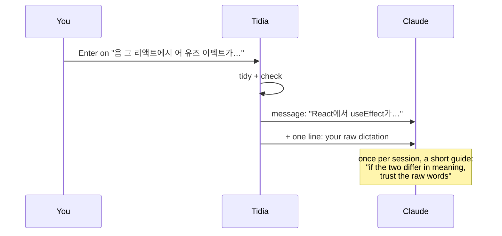
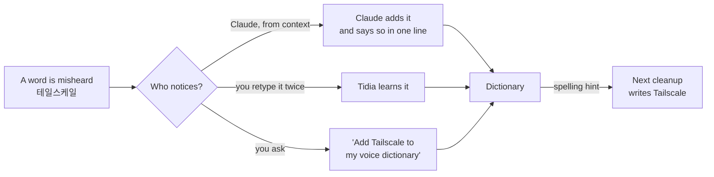

# How Tidia works

[한국어](architecture.ko.md)

## In one picture

Think of Tidia as a careful friend who stands between your microphone and Claude. You talk, the microphone writes what it heard into the prompt box, and when you press Enter the friend quickly rewrites it neatly. Before handing it over, the friend checks the rewrite still says what you said. If anything looks off, your original words go instead.



Tidia never hears audio. It only sees the text Claude Code's own dictation types into the box.

## Step by step

### 1. Telling speech from typing

Claude Code does not say "this text came from the microphone", so Tidia watches. Every quarter second it reads the prompt box. Typing fires a keystroke event; the microphone does not. Text that grows with no keystrokes, by three words or more, is a dictation. Typing is never tidied.



Only the spoken part is tidied. Words you typed before or after it stay as they are.

### 2. Tidying, once, at Enter

When you press Enter, Tidia holds the send for a few seconds and asks the model (sonnet by default) to clean the spoken part. With the dictation it sends:

- up to 300 characters of the prompt on each side, so the cleanup fits the sentence around it;
- spelling hints: your dictionary and the file and identifier names from the last few messages;
- your output rules, such as "write bug reports as what happens, steps, expected".

The model drops fillers and false starts, keeps what you settled on after a self-correction, turns phonetic English back into English ("리액트" → React), and applies your rules. It does not answer, translate or summarize.

### 3. The safety check

A model can get it wrong, so every cleanup passes a check written in plain code before it is sent:

| Check | Catches |
|---|---|
| empty | nothing came back |
| negation | "do it" became "don't do it", or the other way round |
| answer | a long request came back as a two-word reply |
| script | the dictation was translated or came back garbled |
| length | far shorter or longer than what you said |
| overlap | too few of your own words are left |
| added | words or whole lines you never said were made up |

Any failure sends your original instead. The negation check knows eight languages (Korean, English, Japanese, Chinese, Spanish, German, French, Portuguese); the others work in any language.

### 4. What Claude receives



Claude gets exactly two things for a tidied message:

**1. The message**, as it shows in your chat:

```text
React에서 useEffect가 두 번 실행돼. 개발 모드에서만 그래. 왜 그런지 한 줄로 알려 줘.
```

**2. One line beside it**, which Claude sees and your message row does not. It holds a fixed sentence and your raw dictation as a JSON string, nothing else: no settings, rules or dictionary.

```text
[tidia] Dictated by voice and tidied before sending; where the meaning differs, this raw transcript is what the user said (JSON): "음 그러니까 리액트에서 유즈 이펙트가 어 두 번 실행되는데 아 아니 개발 모드에서만 그래 왜 그런지 한 줄로 알려 줘"
```

If you edited the cleanup by hand before sending, the sentence changes to `Dictated by voice, tidied, then edited by hand: the message above is what the user meant. Raw transcript, for reference (JSON): …`. Typed messages and dictations that came back unchanged get no line. `attach_raw off` turns it off.

Why send it: speech loses its intonation, so a question can come out as a statement, and a cleanup can miss. With the raw words beside the message, Claude can check what you actually said and ask when it reads either way. The once-per-session guide (sent again after a compaction) tells Claude exactly that, and when to add a misheard word to your dictionary or offer a rule.

### 5. Getting better over time



Rules work the same way: say how your dictated messages should read, Claude proposes a rule, you allow it in a dialog.

## What is kept on your computer

Everything lives in the mod's own store, on your machine:

- your last 50 tidied messages (what you said, what was sent), so they show the same after a restart;
- your dictionary and up to 200 learned word pairs;
- your output rules.

No audio, no other server, no telemetry. The only network call is the cleanup itself, through the session's own Anthropic connection.

## Code map

| Where | What it does |
|---|---|
| `hooks/register.ts` | Wires everything into Claude Code: polls the box, runs the cleanup at Enter, adds the raw note, draws the message rows, registers `/tidia` and Claude's three tools. |
| `src/detector.ts` | Decides when the text in the box is a dictation. |
| `src/segment.ts`, `src/diff.ts` | Finds the spoken part, and what changed. |
| `src/cleaner.ts` | Builds the model request and reads its reply. |
| `src/guard.ts` | The safety check above. |
| `src/rules.ts` | Output rules and the seven starters. |
| `src/dict/` | Dictionary, learning from your corrections, sound-alike matching, `/tidia dict build`. |
| `src/language.ts`, `src/tokens.ts` | Writing systems and word counting across languages. |
| `src/ui/` | The band above the prompt, the message rows, the dictionary pane. |
| `src/config.ts`, `src/settings.ts`, `src/migrate.ts` | Settings, `/tidia set`, and moving settings saved by older versions. |
| `src/i18n.ts` | Interface text in eight languages. |
